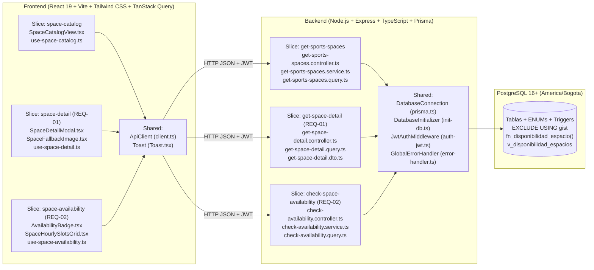

# UNALSpace — Sistema Integral para la Gestión y Reserva de Espacios Universitarios (MVP · Incremento 1)

**Universidad Nacional de Colombia — Sede Bogotá · Facultad de Ingeniería**  
**Asignatura:** Ingeniería de Software I  
**Equipo de Desarrollo:**
- **Oscar Andrés Andrade Medina** (`@oscarmedina0116`)
- **Oscar David Ariza Rojas** (`@OarizaR`)
- **David Fernando Ordoñez Pérez** (`@dordonezpe`)
- **Juan Sebastián Rodríguez León** (`@jrodriguezleo`)

---

## Tabla de Contenidos
1. [Contexto y Alcance del Primer Incremento (MVP / Sprint 1)](#1-contexto-y-alcance-del-primer-incremento-mvp--sprint-1)
2. [Arquitectura del Sistema: Vertical Slice Architecture (VSA)](#2-arquitectura-del-sistema-vertical-slice-architecture-vsa)
3. [Estructura Completa del Repositorio](#3-estructura-completa-del-repositorio)
4. [Stack Tecnológico y Decisiones de Arquitectura (ADRs)](#4-stack-tecnológico-y-decisiones-de-arquitectura-adrs)
5. [Convenciones de Nombramiento y Estándares de Documentación](#5-convenciones-de-nombramiento-y-estándares-de-documentación)
6. [Casos de Uso y Criterios de Aceptación Implementados](#6-casos-de-uso-y-criterios-de-aceptación-implementados)
7. [Referencia de Endpoints de la API REST](#7-referencia-de-endpoints-de-la-api-rest)
8. [Guía de Instalación y Ejecución Paso a Paso](#8-guía-de-instalación-y-ejecución-paso-a-paso)
9. [Pruebas Automatizadas](#9-pruebas-automatizadas)
10. [Licencia de Software (MIT License)](#10-licencia-de-software-mit-license)

---

## 1. Contexto y Alcance del Primer Incremento (MVP / Sprint 1)

**UNALSpace** centraliza la consulta en tiempo real de la disponibilidad, ubicación de referencia y características físicas de los espacios universitarios de la **Universidad Nacional de Colombia (Sede Bogotá)**, evitando desplazamientos innecesarios de los estudiantes y conflictos de horario.

En este **Primer Incremento (Sprint 1 / MVP)**, el alcance funcional cubre exclusivamente el módulo de **Espacios Deportivos** del campus (12 escenarios inventariados en **PostgreSQL 16+**):

| Código | Escenario Deportivo | Edificio / Sector | Cobertura | Superficie |
| :--- | :--- | :--- | :--- | :--- |
| `EST-001` | **Estadio Alfonso López Pumarejo** | Edificio Alfonso López | Destechada | Grama Natural |
| `CON-001` | **Concha Acústica – Cancha Mixta 1** | Edificio 761 | Techada | Cemento / Concreto |
| `CON-002` | **Concha Acústica – Cancha Mixta 2** | Edificio 761 | Techada | Cemento / Concreto |
| `TCH-001` | **Cancha Techada Mixta 1** | Zona Deportiva Cubierta | Techada | Caucho Sintético |
| `TCH-002` | **Cancha Techada Mixta 2** | Zona Deportiva Cubierta | Techada | Caucho Sintético |
| `DES-001` | **Cancha Destechada Mixta 1** | Zona Deportiva Exterior | Destechada | Cemento / Concreto |
| `DES-002` | **Cancha Destechada Mixta 2** | Zona Deportiva Exterior | Destechada | Cemento / Concreto |
| `DES-003` | **Cancha Destechada Mixta 3** | Zona Deportiva Exterior | Destechada | Cemento / Concreto |
| `BAL-001` | **Cancha de Baloncesto Azul** | Zona Deportiva Exterior | Destechada | Caucho Sintético |
| `TEN-001` | **Cancha de Tenis 1** | Sector Tenis | Destechada | Polvo de Ladrillo (Clay) |
| `TEN-002` | **Cancha de Tenis 2** | Sector Tenis | Destechada | Polvo de Ladrillo (Clay) |
| `TEN-003` | **Cancha de Tenis 3 (En Mantenimiento)** | Sector Tenis | Destechada | Polvo de Ladrillo (Clay) |

---

## 2. Arquitectura del Sistema: Vertical Slice Architecture (VSA)

Todo el sistema (tanto **Backend** como **Frontend**) está diseñado e implementado estrictamente bajo **Vertical Slice Architecture (VSA)**. No existen capas horizontales genéricas (`controllers/`, `services/`, `repositories/` globales); cada caso de uso es un **Slice vertical autónomo** que encapsula de punta a punta sus rutas, controladores, validaciones DTO, lógica de negocio y consultas directas a **PostgreSQL 16+**.



---

## 3. Estructura Completa del Repositorio

```text
├── backend/
│   ├── prisma/
│   │   └── schema.prisma                          # Esquema Prisma mapeado a PostgreSQL 16+
│   ├── src/
│   │   ├── features/
│   │   │   ├── get-sports-spaces/                 # SLICE: Catálogo y filtros de espacios deportivos
│   │   │   │   ├── get-sports-spaces.controller.ts
│   │   │   │   ├── get-sports-spaces.service.ts
│   │   │   │   ├── get-sports-spaces.query.ts
│   │   │   │   └── get-sports-spaces.dto.ts
│   │   │   ├── get-space-detail/                  # SLICE [REQ-01]: Detalle, foto y ubicación
│   │   │   │   ├── get-space-detail.controller.ts
│   │   │   │   ├── get-space-detail.query.ts
│   │   │   │   └── get-space-detail.dto.ts
│   │   │   ├── check-space-availability/          # SLICE [REQ-02]: Disponibilidad en tiempo real
│   │   │   │   ├── check-availability.controller.ts
│   │   │   │   ├── check-availability.service.ts
│   │   │   │   ├── check-availability.query.ts    # Invoca fn_disponibilidad_espacio() en Postgres
│   │   │   │   └── check-availability.dto.ts
│   │   │   └── vertical-slices.test.ts            # Suite de pruebas unitarias (Vitest)
│   │   ├── shared/
│   │   │   ├── constants/app-constants.ts         # Constantes globales en UPPER_SNAKE_CASE
│   │   │   ├── database/prisma.ts                 # Singleton PrismaClient conectado a PostgreSQL
│   │   │   ├── database/init-db.ts                # Auto-inicializador de DB-UnalSpace.sql
│   │   │   ├── middlewares/auth-jwt.ts            # Emisión y validación JWT (@unal.edu.co)
│   │   │   └── middlewares/error-handler.ts       # Control de timeout (< 10s) y manejo de errores
│   │   └── server.ts                              # Punto de entrada del servidor HTTP (Puerto 3001)
│   ├── .env.example
│   ├── package.json
│   └── tsconfig.json
├── frontend/
│   ├── public/
│   │   └── logos/                                 # Versiones oficiales del logotipo UNALSpace
│   ├── src/
│   │   ├── features/
│   │   │   ├── space-catalog/                     # SLICE: Catálogo interactivo y filtros
│   │   │   │   ├── SpaceCatalogView.tsx
│   │   │   │   └── use-space-catalog.ts
│   │   │   ├── space-detail/                      # SLICE [REQ-01]: Modal <dialog>, fallbacks CA #3/#4/#6
│   │   │   │   ├── SpaceDetailModal.tsx
│   │   │   │   ├── SpaceFallbackImage.tsx
│   │   │   │   ├── space-detail.types.ts
│   │   │   │   └── use-space-detail.ts
│   │   │   └── space-availability/                # SLICE [REQ-02]: Badges y grilla horaria (06:00-21:00)
│   │   │       ├── AvailabilityBadge.tsx
│   │   │       ├── SpaceHourlySlotsGrid.tsx
│   │   │       ├── space-availability.types.ts
│   │   │       └── use-space-availability.ts
│   │   ├── shared/
│   │   │   ├── api/client.ts                      # Cliente HTTP con timeout de 10s y JWT
│   │   │   └── components/Toast.tsx               # Notificaciones emergentes Popover Top-Layer (CA #5)
│   │   ├── App.tsx
│   │   ├── main.tsx
│   │   └── index.css
│   ├── index.html
│   ├── package.json
│   ├── tailwind.config.js
│   ├── tsconfig.json
│   └── vite.config.ts
├── docs/
│   ├── adr/
│   │   ├── 0001-usar-postgresql-como-base-de-datos-principal.md
│   │   └── 0002-vertical-slice-architecture-fullstack.md
│   └── rfc/
│       └── rfc-001-incremento-1-espacios-deportivos.md
├── 01_extensions_and_enums.sql                    # Extensiones (uuid-ossp, btree_gist) y ENUMs
├── 02_schema_ddl.sql                              # Tablas relacionales e índices GiST anti-solapamiento
├── 03_triggers_and_validations.sql                # Triggers de validación horaria y de disciplinas
├── 04_seed_data.sql                               # Datos semilla de los 12 espacios deportivos UNAL
├── 05_views_and_queries.sql                       # Vistas y función fn_disponibilidad_espacio()
├── DB-UnalSpace.sql                               # Script maestro consolidado de PostgreSQL 16+
├── documentacion_bd_unal_space.tex                # Documentación técnica de la Base de Datos en LaTeX
├── docker-compose.yml                             # Contenedor PostgreSQL 16-alpine (America/Bogota)
├── adr_template.md                                # Plantilla institucional para ADRs
├── rfc_template.md                                # Plantilla institucional para RFCs
└── README.md
```

---

## 4. Stack Tecnológico y Decisiones de Arquitectura (ADRs)

| Capa | Tecnología | Justificación Arquitectónica |
| :--- | :--- | :--- |
| **Base de Datos** | **PostgreSQL 16+** (`America/Bogota`) | Garantiza integridad referencial ACID, tipos enumerados nativos (`tipo_espacio`, `tipo_superficie`, `deporte_permitido`, `estado_reserva`), restricción anti-solapamiento `EXCLUDE USING gist (espacio_id WITH =, rango_horario WITH &&)`, triggers de validación (`fn_validar_reserva`) y la función nativa `fn_disponibilidad_espacio(UUID, DATE)`. Ver [ADR-0001](docs/adr/0001-usar-postgresql-como-base-de-datos-principal.md). |
| **ORM & Acceso a Datos** | **Prisma ORM** + Consultas SQL Nativas | Mapeo fuertemente tipado del esquema relacional e invocación directa de funciones y vistas de PostgreSQL (`fn_disponibilidad_espacio`, `v_disponibilidad_espacios`). |
| **Backend** | **Node.js + Express.js (TypeScript)** | Modularidad bajo Vertical Slice Architecture ([ADR-0002](docs/adr/0002-vertical-slice-architecture-fullstack.md)), validación de esquemas con Zod y autenticación local JWT para correos `@unal.edu.co`. |
| **Frontend** | **React 19 + Vite + Tailwind CSS + TanStack Query** | Sincronización reactiva en tiempo real, componentes nativos accesibles (`<dialog>`, `[popover="manual"]`, `<search>`) y diseño responsivo con identidad institucional UNALSpace. |

---

## 5. Convenciones de Nombramiento y Estándares de Documentación

Todo el código fuente del proyecto cumple rigurosamente con la tabla de convenciones acordada por el equipo:

| Elemento | Convención | Ejemplos Reales en el Código |
| :--- | :--- | :--- |
| **Clases** | `PascalCase`, sustantivos | `SpaceDetailService`, `SpaceCatalogService`, `CheckAvailabilityController`, `JwtAuthMiddleware` |
| **Métodos y Funciones** | `camelCase`, empiezan con verbo | `getSpaceDetailById()`, `getSportsSpacesCatalog()`, `checkSpaceAvailability()`, `renderSpaceCatalogView()` |
| **Variables** | `camelCase`, descriptivas (sin abreviaturas) | `searchParameters`, `queryString`, `encodedSpaceId`, `requestEndpoint`, `apiResponse` |
| **Constants** | `UPPER_SNAKE_CASE` | `SPACE_DETAIL_QUERY_KEY`, `API_BASE_URL`, `DEFAULT_FALLBACK_IMAGE`, `API_TIMEOUT_MS` |
| **Archivos** | `kebab-case` o igual que la clase | `use-space-detail.ts`, `get-space-detail.controller.ts`, `SpaceCatalogView.tsx`, `AvailabilityBadge.tsx` |
| **Carpetas** | `kebab-case` o minúsculas | `space-detail/`, `space-catalog/`, `check-space-availability/`, `shared/` |

### Acuerdo de Documentación de Métodos (JSDoc / TSDoc)
Cada método y función del sistema incluye su bloque de documentación especificando:
1. **Descripción:** Qué hace el método.
2. **Parámetros (`@param`):** Nombre, tipo y propósito de cada parámetro recibido.
3. **Retorno (`@returns`):** Tipo y descripción del valor devuelto.

---

## 6. Casos de Uso y Criterios de Aceptación Implementados

### SLICE 1: Consultar Disponibilidad de Espacios (`[REQ-02]` — Capstone)
- **CA #1 (Disponible):** Si el espacio no tiene reservas activas (`PENDIENTE` o `CONFIRMADA`) en el bloque consultado en PostgreSQL, muestra el indicador verde **`"Disponible"`**.
- **CA #2 (Ocupado):** Si el espacio tiene una reserva activa en ese bloque, muestra el indicador rojo **`"Ocupado"`**.
- **CA #3 (Múltiples espacios):** El catálogo muestra simultáneamente el estado individualizado de los espacios deportivos, permitiendo filtrarlos por deporte, tipo de escenario, condición de techo y estado.
- **CA #4 (Estado no registrado - Alternativa):** Si el espacio no tiene registrada su disponibilidad, muestra exactamente el texto **`"Disponibilidad no registrada"`**.
- **CA #5 (Fallo de conexión o timeout - Excepción):** Despliega una notificación emergente (Toast):  
  `"Error de conexión. No se pudo cargar el estado de disponibilidad. Revisa tu conexión a internet e inténtalo nuevamente."`

### SLICE 2: Consultar Detalle y Ubicación de Espacios (`[REQ-01]`)
- **CA #1 (Información y foto):** Al hacer clic en cualquier tarjeta o ilustración de cancha, abre el modal con su fotografía/ilustración representativa de alta resolución y sus características físicas (capacidad, condición techada/destechada, superficie de juego y deportes permitidos).
- **CA #2 (Ubicación de referencia):** Muestra el nombre/número del edificio y su ubicación relativa dentro del campus (ej. `Edificio 761 — Zona Deportiva`).
- **CA #3 (Sin fotografía - Alternativa):** Si el espacio no tiene fotografía registrada en la base de datos, muestra el componente institucional con el texto exacto **`"Imagen no disponible"`** sin romper el diseño.
- **CA #4 (Datos incompletos - Alternativa):** Si faltan características físicas, muestra exactamente el texto **`"Características físicas aún no registradas"`**.
- **CA #5 (Fallo de conexión o timeout - Excepción):** Despliega una notificación emergente (Toast):  
  `"Error de conexión. No se pudo cargar la información detallada del espacio. Revisa tu conexión a internet e inténtalo nuevamente."`
- **CA #6 (Espacio no encontrado / ID inválido - Excepción):** Si se consulta un ID inexistente o retirado, muestra exactamente:  
  `"El espacio solicitado no existe o fue retirado del sistema."`

---

## 7. Referencia de Endpoints de la API REST

| Método | Ruta | Slice Vertical | Descripción |
| :--- | :--- | :--- | :--- |
| `GET` | `/api/health` | `shared` | Estado de salud del servidor, arquitectura VSA y zona horaria `America/Bogota`. |
| `GET` | `/api/auth/session` | `shared/auth-jwt` | Obtiene la sesión estudiantil activa (`@unal.edu.co`) y el listado de perfiles de prueba. |
| `POST` | `/api/auth/session` | `shared/auth-jwt` | Confirma un correo institucional `@unal.edu.co` y emite un token JWT firmado. |
| `GET` | `/api/spaces` | `get-sports-spaces` | Lista y filtra el catálogo de espacios deportivos con su estado de disponibilidad en vivo. |
| `GET` | `/api/spaces/:id` | `get-space-detail` | **REQ-01:** Retorna la ficha técnica completa, imagen, ubicación y estado actual del espacio. |
| `GET` | `/api/availability/:id` | `check-space-availability` | **REQ-02:** Ejecuta `fn_disponibilidad_espacio(UUID, DATE)` devolviendo las 15 franjas horarias (06:00–21:00). |
| `POST` | `/api/availability/reservations` | `check-space-availability` | Registra una reserva en PostgreSQL validando la restricción `EXCLUDE USING gist`. |
| `DELETE` | `/api/availability/reservations/:spaceId` | `check-space-availability` | Cancela reservas activas en la franja consultada para reflejar el paso inmediato a `"Disponible"`. |

---

## 8. Guía de Instalación y Ejecución Paso a Paso

### Requisitos Previos
- **Node.js** `v20+` y **npm** `v10+`.
- **PostgreSQL** `16+` (local en puerto `5432` o mediante **Docker Compose**).

### Paso 1: Levantar la Base de Datos PostgreSQL 16+
Puedes usar Docker Compose (que carga automáticamente `DB-UnalSpace.sql`) o una instancia local de PostgreSQL:

```bash
# Opción A: Con Docker Compose
docker compose up -d
```

> **Inicialización automática:** Al arrancar el backend, `DatabaseInitializer` verifica automáticamente si la base de datos `unal_space` existe en `localhost:5432` y ejecuta `DB-UnalSpace.sql` junto con datos semilla del día hábil actual si aún no ha sido creada.

### Paso 2: Instalar y Ejecutar el Backend (Puerto `3001`)
```bash
cd backend
cp .env.example .env
npm install
npx prisma generate
npm run dev
```

### Paso 3: Instalar y Ejecutar el Frontend (Puerto `5173`)
En una nueva terminal:
```bash
cd frontend
npm install
npm run dev
```

Abre en el navegador: **`http://localhost:5173`**

---

## 9. Pruebas Automatizadas

Para ejecutar la suite de pruebas unitarias de los Vertical Slices (`REQ-01`, `REQ-02` y autenticación institucional JWT `@unal.edu.co`):

```bash
cd backend
npm test
```

Para verificar la compilación estricta de TypeScript en ambos proyectos:

```bash
npm --prefix backend run build
npm --prefix frontend run build
```

---

## 10. Licencia de Software (MIT License)

Este proyecto se distribuye bajo la **Licencia MIT (MIT License)** con fines académicos e institucionales para la **Universidad Nacional de Colombia (Sede Bogotá)**.

```text
MIT License

Copyright (c) 2026 UNALSpace Team — Universidad Nacional de Colombia (Sede Bogotá)
Oscar Andrés Andrade Medina, Oscar David Ariza Rojas,
David Fernando Ordoñez Pérez, Juan Sebastián Rodríguez León

Permission is hereby granted, free of charge, to any person obtaining a copy
of this software and associated documentation files (the "Software"), to deal
in the Software without restriction, including without limitation the rights
to use, copy, modify, merge, publish, distribute, sublicense, and/or sell
copies of the Software, and to permit persons to whom the Software is
furnished to do so, subject to the following conditions:

The above copyright notice and this permission notice shall be included in all
copies or substantial portions of the Software.

THE SOFTWARE IS PROVIDED "AS IS", WITHOUT WARRANTY OF ANY KIND, EXPRESS OR
IMPLIED, INCLUDING BUT NOT LIMITED TO THE WARRANTIES OF MERCHANTABILITY,
FITNESS FOR A PARTICULAR PURPOSE AND NONINFRINGEMENT. IN NO EVENT SHALL THE
AUTHORS OR COPYRIGHT HOLDERS BE LIABLE FOR ANY CLAIM, DAMAGES OR OTHER
LIABILITY, WHETHER IN AN ACTION OF CONTRACT, TORT OR OTHERWISE, ARISING FROM,
OUT OF OR IN CONNECTION WITH THE SOFTWARE OR THE USE OR OTHER DEALINGS IN THE
SOFTWARE.
```
