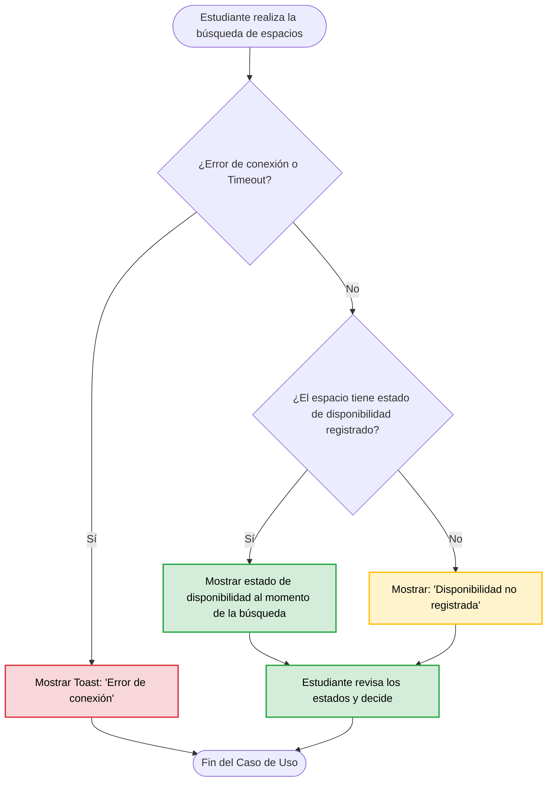

# [REQ-02] — Consulta del estado de disponibilidad de espacios universitarios

| | |
|---|---|
| **Status** | Draft |
| **Team / Author(s)** | Oscar Andres Andrade Medina, Oscar David Ariza Rojas, David Fernando Ordoñez Pérez, Juan Sebastián Rodríguez León |
| **Date** | 16 de Octubre de 2026 |
| **Linked User Story / AC** | HU-001 "User Story UNAL-SPACE" — *Pendiente de confirmar qué Criterios de Aceptación de la HU cubren este requerimiento (ver Open Question #1).* |

---

## 1. Overview

**Requirement Statement**
> El sistema deberá permitir a los estudiantes consultar el estado de disponibilidad de cualquier espacio universitario al momento de realizar la búsqueda.

**Type:** Functional (Filtro de la Tecnología Perfecta: con una computadora perfecta —velocidad infinita, memoria ilimitada, cero fallos— el estudiante seguiría necesitando saber si el espacio está disponible. La necesidad no desaparece → funcional. Nota: la expectativa de "al momento de la búsqueda" (qué tan actualizado debe estar el dato) es un aspecto de calidad que se deja como Open Question, no se mezcla aquí).

**Source / Evidence**
> Requerimiento formulado por el equipo para UNAL-SPACE. **Evidencia primaria pendiente:** aún no está referenciada la entrevista, entrada del Discovery Sheet o minuta de donde proviene (ver Open Question #1).

**Need**
> Saber si un espacio del campus está disponible en este momento, para decidir si ir a él o buscar otra opción sin perder tiempo.

**Value / Rationale**
> Evitar desplazamientos inútiles hacia espacios no disponibles y tomar decisiones rápidas sobre qué espacio usar.

---

## 2. Context — A Requirement Rarely Stands Alone

**Business Rule(s)**
> N/A — none identified. Hasta ahora no se ha identificado ninguna regla del dominio (por ejemplo, quién puede usar qué espacio o con qué antelación) que este requerimiento deba hacer cumplir; el requerimiento solo pide mostrar el estado.

**Constraint(s)**
> N/A — none identified. No se ha identificado ninguna regulación, tecnología obligatoria o política institucional que limite cómo resolver este requerimiento.

**Assumption(s)**
> - Cada espacio tiene un identificador único (heredado de REQ-01). (No verificado formalmente).
> - Es posible determinar el estado de disponibilidad de cada espacio con la información que maneja el sistema. (No verificado: depende de la Open Question #2).
> - El estado de disponibilidad se puede expresar con un conjunto finito y claro de valores (por ejemplo, "Disponible" / "Ocupado"). (No verificado: depende de la Open Question #3).
> - Los estudiantes consultan la disponibilidad desde la aplicación con conexión a internet.

**Dependenc(ies)**
> - **REQ-01:** el estado se muestra sobre los espacios que ya se listan y detallan en esa consulta.
> - **Fuente de datos de disponibilidad:** algo que indique si un espacio está libre u ocupado (agenda/reservas del sistema de agendamiento o actualización manual desde el panel administrativo). Aún no definida.
> - Base de datos centralizada de espacios.
> - Conexión a internet estable por parte del estudiante.

**Risk(s)**
> Derivados principalmente de la calidad del dato de disponibilidad y de los errores de carga.

| Risk | Likelihood | Impact | Mitigation (optional) |
|---|---|---|---|
| Dato de disponibilidad desactualizado (el espacio aparece libre pero ya está ocupado, o viceversa) | Medio | Alto | Definir la fuente de verdad y la frecuencia de actualización antes de diseñar (Open Questions #2 y #4). |
| No existe una fuente confiable del estado (por ejemplo, las reservas se pospusieron en REQ-01) | Medio | Alto | Resolver la Open Question #2 antes de comprometer alcance. |
| Espacio sin estado de disponibilidad registrado | Medio | Medio | Mostrar texto por defecto "Disponibilidad no registrada" sin romper la interfaz. |
| Fallo de conexión o timeout | Medio | Bajo | Desplegar Toast: "Error de conexión. No se pudo cargar el estado de disponibilidad. Revisa tu conexión a internet e inténtalo nuevamente." |

**Open Questions**
> 1. **Evidencia primaria y HU:** Falta referenciar la entrevista/Discovery Sheet de donde sale este requerimiento y confirmar con qué Criterios de Aceptación de la HU-001 se relaciona.
> 2. **Fuente de la disponibilidad:** ¿El estado se calcula a partir de reservas/agenda del sistema de agendamiento o lo actualiza manualmente un administrador? En REQ-01 se pospusieron las reservas, por lo que hay que definir cómo se obtiene este dato en el MVP.
> 3. **Definición de "disponibilidad":** ¿Qué estados existen? ¿Solo "Disponible" / "Ocupado" o también "Reservado", "En mantenimiento", etc.? (Esto cierra parcialmente la Open Question #3 de REQ-01.)
> 4. **Alcance de "al momento de realizar la búsqueda":** ¿Significa el instante actual o una fecha/franja horaria elegida por el estudiante? ¿Qué desfase máximo es aceptable entre el estado real y el mostrado?
> 5. **"Búsqueda":** REQ-01 describe una lista de espacios y su detalle, pero no una función de búsqueda. ¿Existe (o existirá) un buscador/filtro? ¿Dónde se muestra el estado: en la lista, en el detalle, o en ambos?
> 6. **"Cualquier espacio":** ¿Aplica a todos los tipos de espacio (canchas, laboratorios, etc.), incluidos aquellos que no se pueden agendar?

---

## 3. Priority & Estimation

**Priority model used:** MoSCoW
**Priority assigned:** (S) Should Have

> Debido a que REQ-01 ya resuelve la necesidad principal de UNAL-SPACE (saber qué es y dónde está un espacio) y que la disponibilidad depende de una fuente de datos que aún no está definida, le asignamos **Should Have**, aceptando el costo de que, mientras no se implemente, los estudiantes puedan desplazarse a espacios ocupados. Consideramos asignarle **Must Have**, pero lo descartamos porque el producto ya entrega valor sin este requerimiento y su alcance todavía tiene preguntas abiertas que impiden comprometerlo como esencial. *Esta prioridad deberá revisarse si la evidencia (Open Question #1) muestra que la disponibilidad es la necesidad central del sistema de agendamiento.*

**Estimate (confidence):** Low
> **How sure are we about the size and shape of this work?** Confianza Baja (Low). La interfaz (mostrar un estado) es sencilla, pero hay incertidumbre alta: no sabemos de dónde saldrá el dato de disponibilidad, qué estados existen ni qué tan actualizado debe estar. Estas incógnitas (Open Questions #2, #3 y #4) pueden cambiar mucho el tamaño real del trabajo.

---

## 4. Representations — Requirement ≠ Representation

### 4.1 User Story

> Como **[estudiante]**,
> quiero **[consultar el estado de disponibilidad de un espacio universitario al momento de realizar mi búsqueda]**,
> tal que **[pueda decidir rápidamente si ir a ese espacio o buscar otra opción, sin desplazarme en vano]**.

### 4.2 Acceptance Criteria

**Scenario 1 — [Espacio disponible]**
> **Given** [que soy un estudiante que realiza una búsqueda de espacios universitarios]
> **When** [el sistema muestra un espacio que en ese momento está libre]
> **Then** [el sistema indica de forma visible el estado "Disponible" para ese espacio.]

**Scenario 2 — [Espacio no disponible]**
> **Given** [que soy un estudiante que realiza una búsqueda de espacios universitarios]
> **When** [el sistema muestra un espacio que en ese momento está ocupado]
> **Then** [el sistema indica de forma visible el estado "Ocupado" para ese espacio.]

**Scenario 3 — [Varios espacios en una misma búsqueda]**
> **Given** [que la búsqueda devuelve varios espacios universitarios con estados distintos]
> **When** [reviso los resultados]
> **Then** [el sistema muestra el estado de disponibilidad correspondiente a cada espacio, de modo que pueda distinguirlos entre sí.]

**Scenario 4 — [Estado no registrado (alternativa)]**
> **Given** [que el espacio consultado no tiene un estado de disponibilidad registrado]
> **When** [realizo la búsqueda o consulto su información]
> **Then** [el sistema muestra el texto "Disponibilidad no registrada" en lugar de un espacio en blanco o errores de código.]

**Scenario 5 — [Fallo de conexión o timeout (excepción)]**
> **Given** [que estoy consultando la disponibilidad de los espacios]
> **When** [ocurre un fallo de conexión o timeout en el dispositivo]
> **Then** [el sistema muestra una alerta tipo toast: "Error de conexión. No se pudo cargar el estado de disponibilidad. Revisa tu conexión a internet e inténtalo nuevamente."]

### 4.3 Use Case

| Field | |
|---|---|
| **Use Case name** | Consultar disponibilidad de espacios del campus |
| **Actor** | Estudiante |
| **Goal** | Conocer si un espacio está disponible al momento de la búsqueda para decidir si ir a él o buscar otro |
| **Trigger** | El estudiante realiza una búsqueda de espacios universitarios |
| **Precondition** | El estudiante se encuentra en la aplicación y tiene conexión a la red |

**Main Flow**
> 1. El estudiante ingresa a la sección de espacios universitarios.
> 2. El estudiante realiza la búsqueda de espacios.
> 3. El sistema consulta el estado de disponibilidad de los espacios encontrados.
> 4. El sistema muestra, junto a cada espacio, su estado de disponibilidad al momento de la búsqueda.
> 5. El estudiante revisa los estados y decide qué espacio utilizar.

**Alternative Flow**
> - [El espacio no tiene estado de disponibilidad registrado] → [el sistema muestra "Disponibilidad no registrada" en el paso 4 y continúa el flujo normal.]

**Exception**
> - [Fallo de conexión o timeout] → [En el paso 3, el sistema muestra un toast de error de conexión y detiene el caso de uso.]

**Postcondition**
> El estudiante ha visualizado el estado de disponibilidad de los espacios (o ha sido informado claramente de por qué no se pudo cargar) y puede usar esa información para decidir a dónde ir.

**Flow Diagram**

---

## 5. Traceability & Impact

**Backward — why does this requirement exist?**
> Evidencia → Necesidad → Requerimiento. La necesidad ("saber si un espacio está disponible ahora para decidir si ir") está identificada, pero la **evidencia primaria aún no está referenciada** (Open Question #1). Además, este requerimiento se relaciona con la Open Question #3 de REQ-01, que ya anticipaba la posibilidad de mostrar un estado dinámico ("Disponible", "Ocupado").

**Forward — what will this affect?**
> Requerimiento → Diseño → Implementación → Pruebas. Se espera que afecte:
> - **Diseño:** el modelo de datos del espacio (atributo de estado), la fuente/actualización de ese dato y la interfaz de lista/detalle de REQ-01 (indicador visual de estado).
> - **Implementación:** consulta del estado junto con la información del espacio y manejo de los casos sin dato y con error de conexión.
> - **Pruebas:** un caso de prueba por cada escenario de aceptación (5 en total).
>
> *Se actualizará cuando inicie el trabajo de Diseño (Clase 11).*

**Impact Analysis — if this requirement changes, what else might need to change?**
- [ ] Business Rules
- [ ] Constraints
- [x] Dependencies
- [x] Risks
- [x] Acceptance Criteria
- [x] Estimate
- [x] Priority
- [x] Future Design
- [x] Future Tests

> Si cambia la definición de "disponibilidad" o su fuente (por ejemplo, pasar de actualización manual a reservas): cambian las **dependencias** y los **riesgos** (dato desactualizado), los **criterios de aceptación** (estados y tiempos), la **estimación** y la **prioridad**, y por tanto el **diseño** y las **pruebas** futuras. No se identifican Reglas de Negocio ni Restricciones afectadas, porque por ahora no hay ninguna registrada. También habría que actualizar la Open Question #3 de REQ-01.

---

## 6. Validation — Quality Gate

- [ ] **Valid?** Falta la evidencia primaria (Open Question #1); la necesidad parece real pero aún no está respaldada.
- [ ] **Clear / Unambiguous?** "Disponibilidad", "al momento de realizar la búsqueda" y "cualquier espacio" admiten varias interpretaciones (Open Questions #3, #4, #5, #6).
- [x] **Atomic?** Expresa una sola expectativa verificable: mostrar el estado de disponibilidad de un espacio.
- [x] **Necessary?** Sin ella, el estudiante puede desplazarse a un espacio ocupado, lo cual afecta directamente el objetivo del sistema de agendamiento.
- [ ] **Feasible?** Depende de que exista una fuente confiable del estado (Open Question #2).
- [ ] **Verifiable?** Los escenarios son verificables, pero falta definir los estados posibles y el desfase aceptable del dato para poder verificar "al momento".
- [ ] **Consistent?** Por confirmar: REQ-01 pospuso las reservas, y la disponibilidad podría depender de ellas (Open Question #2).
- [ ] **Complete enough?** Faltan definir estados de disponibilidad y dónde se muestran.
- [ ] **Traceable?** Falta enlazar la evidencia primaria y los Criterios de Aceptación de la HU.

> **Qué falta:** las preguntas #1 y #5 envían de vuelta a **Clase 8 (re-elicitar)** con los stakeholders; las #2, #3, #4 y #6 envían a **Clase 9 (re-especificar)** una vez se tengan las respuestas. Mientras tanto el requerimiento permanece en **Draft**.
