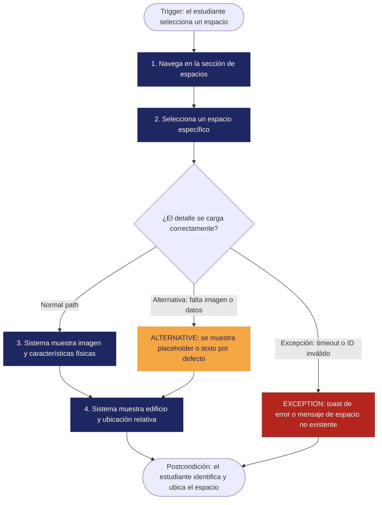

<!--
HOW TO USE THIS TEMPLATE
------------------------
1. Copy this file and rename it to the requirement's ID, e.g. REQ-01.md.
2. Fill in every section. If a section genuinely does not apply to this
   requirement (not every requirement has a Business Rule or a Constraint),
   write "N/A — none identified" and say why in one line. Never invent
   content to fill a blank cell — that breaks the rule we've followed since
   Class 8: specification is not invention.
3. If something is unknown rather than inapplicable, use the Open
   Questions section instead of guessing.
4. See REQ-07_Example.md (Food Delivery System) for a fully filled-in
   reference before you start.
-->

# [REQ-01] — [Short Requirement Title]

| | |
|---|---|
| **Status** | Draft |
| **Team / Author(s)** | Oscar Andres Andrade Medina, Oscar David Ariza Rojas, David Fernando Ordoñez Pérez, Juan Sebastián Rodríguez León |
| **Date** | 09 de Octubre de 2026 |
| **Linked User Story / AC** | HU-001 "User Story UNAL-SPACE" — Criterios de Aceptación #1 y #2 |

---

## 1. Overview

**Requirement Statement**
> El sistema deberá mostrar la información detallada de cada cancha y laboratorio, incluyendo su imagen representativa, su descripción de características físicas y su ubicación puntual.

**Type:** Functional (Filtro de la Tecnología Perfecta: con una computadora perfecta —velocidad infinita, memoria ilimitada, cero fallos— el estudiante seguiría necesitando ver la foto, las características y la ubicación del espacio. La necesidad no desaparece → funcional. 

**Source / Evidence**
> Entrevista mediada en clase para conocer los requerimientos y opiniones sobre la centralización y prioridad del servicio como objeto de situación cotidiana.

**Need**
> Saber cómo es un espacio del campus y dónde está, para reconocerlo y llegar a él sin perderse. 

**Value / Rationale**
> Identificar fácilmente los espacios y orientarse correctamente dentro de la universidad.

---

## 2. Context — A Requirement Rarely Stands Alone

**Business Rule(s)**
> N/A — none identified. 

**Constraint(s)**
> N/A — none identified. 

**Assumption(s)**
> - Cada espacio (cancha o laboratorio) tiene un identificador único, ya que el sistema maneja "ID inválido" y enlaces directos a un espacio.
> - Existe un panel administrativo desde el cual se gestiona la información y el estado de los espacios (mencionado en la prueba de sincronización). No verificado.
> - Las imágenes y datos de los espacios se almacenan en una base de datos (mencionado en "Ausencia de fotografía"). No verificado.

**Dependenc(ies)**
> - Base de datos con la información de los espacios (imagen, características, ubicación).
> - Panel administrativo que carga y actualiza esa información.
> - Conexión a internet del estudiante.

**Risk(s)**
> Derivados únicamente de los escenarios de "Manejo de errores" de la HU. 

| Risk | Likelihood | Impact | Mitigation (optional) |
|---|---|---|---|
| Espacio sin fotografía cargada | Medio | Alto | Imagen por defecto "Imagen no disponible" sin romper el diseño|
| Datos de características físicas incompletos | Medio | Alto | Texto por defecto "Características físicas aún no registradas" | 
|Fallo de conexión o timeout| Medio | Bajo |Toast: "Error de conexión. No se pudo cargar la información detallada del espacio. Revisa tu conexión a internet e inténtalo nuevamente."|
|Enlace a un espacio borrado (ID inválido)| Bajo | Bajo |Mensaje: "El espacio solicitado no existe o fue retirado del sistema."|

**Open Questions**
> 1. "Alta resolución": ¿qué resolución mínima se considera alta? Sin un valor, el criterio no es verificable.
> 2. "Ubicación puntual / exactas": el RF dice "puntual" y la HU dice "exactas", pero el AC #2 solo pide edificio + ubicación relativa en texto. ¿Se requiere mapa o coordenadas?
> 3. Atomicidad: la sección de verificación incluye pruebas de sincronización (cambio de estado desde el panel admin), filtros (búsqueda por nombre/catálogo) y rendimiento (≤ 10 s). Ninguna aparece en los AC ni en el RF-02. ¿Son parte de este requisito o pertenecen a otros (p. ej. búsqueda/filtrado, estado de espacios, requisito no funcional de rendimiento)?
> 4. "Inmediato": ¿qué significa "reflejar el cambio de inmediato" en términos medibles?
> 5. Estado del espacio: la prueba de sincronización habla de "estado" de un espacio, pero ese dato no está en la información que debe mostrarse. ¿Qué es y dónde se muestra?
> 6. "Carga normal": ¿cuántos usuarios concurrentes definen la "carga normal" del criterio de 10 s?
> 7. Alcance: el RF habla de "cancha y laboratorio", pero el AC #1 habla de "espacios universitarios" en general. ¿Hay otros tipos de espacio?

---

## 3. Priority & Estimation

**Priority model used:** MoSCoW / Kano / RICE / WSJF / Value-Effort *(pick the one that fits the decision you're actually making — see Class 10's comparison if you need to decide which)*

**Priority assigned:**
> Because [the situation/signal from your project], we assigned [priority value], accepting the trade-off of [what you're giving up by not prioritizing it higher/lower]. We considered [alternative priority] and didn't use it because [reason].

**Estimate (confidence):** High / Medium / Low
> How sure are we about the size and shape of this work? *(This is a confidence tag, not a technique-based number — named estimation techniques like story points are Ingeniería de Software II content, not this course.)*

---

## 4. Representations — Requirement ≠ Representation

### 4.1 User Story

> Como **[estudiante]**,
> quiero **[consultar la información de los diferentes espacios del campus (fotografía, características físicas y ubicación exactas)]**,
> tal que **[pueda identificarlos fácilmente y orientarme correctamente dentro de la universidad.]**.

### 4.2 Acceptance Criteria

*(At least two scenarios: one normal path, one alternative or exception.)*

**Scenario 1 — [Información visual y descriptiva del espacio]**
> **Given** [que soy un estudiante que navega en la sección de espacios universitarios]
> **When** [selecciono un espacio específico]
> **Then** [el sistema despliega una imagen representativa y de alta resolución del espacio y la descripción de sus características físicas (ej. capacidad, equipamiento, dimensiones o tipo de espacio).]

**Scenario 2 — [Ubicación física y relativa dentro del campus]**
> **Given** [que estoy consultando el detalle de un espacio universitario]
> **When** [reviso el apartado de ubicación]
> **Then** [el sistema muestra el nombre o número del edificio en el que se encuentra y su ubicación relativa en el campus (ej. "Edificio A, 2° piso, al lado de la biblioteca principal").]

**Scenario 3 — [Ausencia de fotografía (alternativa)]**
> **Given** [que el espacio seleccionado no tiene una imagen cargada en la base de datos ]
> **When** [consulto su detalle]
> **Then** [el sistema muestra una imagen por defecto que dice "Imagen no disponible", sin romper el diseño visual de la pantalla.]

**Scenario 4 — [Datos incompletos (alternativa)]**
> **Given** [que faltan datos de características físicas del espacio]
> **When** [consulto su detalle]
> **Then** [el sistema muestra el texto "Características físicas aún no registradas" en lugar de un espacio en blanco o errores de código.]

**Scenario 5 — [Fallo de conexión o timeout (excepción)]**
> **Given** [que estoy consultando el detalle de un espacio]
> **When** [ocurre un fallo de conexión o timeout]
> **Then** [el sistema muestra una alerta (toast): "Error de conexión. No se pudo cargar la información detallada del espacio. Revisa tu conexión a internet e inténtalo nuevamente."]

**Scenario 6 — [Espacio no encontrado (excepción)]**
> **Given** [que ingreso a un enlace de un espacio que fue borrado (ID inválido)]
> **When** [el sistema intenta cargar el espacio]
> **Then** [eel sistema muestra el mensaje: "El espacio solicitado no existe o fue retirado del sistema."]

### 4.3 Use Case

| Field | |
|---|---|
| **Use Case name** | Consultar detalle de un espacio del campus |
| **Actor** | Estudiante |
| **Goal** | Conocer la imagen, características físicas y ubicación de un espacio para identificarlo y llegar a él |
| **Trigger** | El estudiante selecciona un espacio en la sección de espacios universitarios |
| **Precondition** | El estudiante está en la sección de espacios universitarios y el espacio existe en el sistema |

**Main Flow**
1. El estudiante navega en la sección de espacios universitarios.
2. El estudiante selecciona un espacio específico.
3. El sistema despliega la imagen representativa y la descripción de las características físicas del espacio.
4. El estudiante revisa el apartado de ubicación y el sistema muestra el edificio y la ubicación relativa en el campus.

**Alternative Flow**
> [El espacio no tiene imagen] → [el sistema muestra la imagen por defecto "Imagen no disponible" y continúa el flujo.]
> [Faltan características físicas] → [el sistema muestra "Características físicas aún no registradas" y continúa el flujo.]

**Exception**
> [Fallo de conexión o timeout] → [el sistema muestra un toast de error de conexión y no carga el detalle.]
> [ID de espacio inválido (espacio borrado)] → [el sistema muestra "El espacio solicitado no existe o fue retirado del sistema."]

**Postcondition**
> El estudiante ha visualizado la información disponible del espacio (o ha sido informado claramente de por qué no se pudo cargar) y puede identificarlo y ubicarlo en el campus.

**Flow Diagram**
*(Replace the labels below with your own steps. Keep Main Flow, Alternative, and Exception visually distinct — delete whichever branch doesn't apply to your use case. This renders automatically on GitHub.)*

---

## 5. Traceability & Impact

**Backward — why does this requirement exist?**
> Necesidad (identificar y orientarse en el campus) → Requisito RF-02 → HU-001. La evidencia que originó la necesidad (entrevista, taller, observación) no está referenciada en el material disponible; completar con la entrada de la Discovery Sheet cuando se identifique (Open Question 1).

**Forward — what will this affect?**
> Aún no hay Diseño. Se espera que toque: la pantalla de detalle de espacio, el modelo de datos de espacios (imagen, características, edificio/ubicación relativa), el panel administrativo (carga/edición de esos datos) y el manejo de errores de carga. Actualizar cuando empiece el trabajo de la Clase 11.

**Impact Analysis — if this requirement changes, what else might need to change?**
- [ ] Business Rules
- [ ] Constraints
- [x] Dependencies
- [x] Risks
- [x] Acceptance Criteria
- [x] Estimate
- [x] Priority
- [x] Future Design
- [x] Future Tests

> Un cambio (p. ej. pedir mapa interactivo en vez de ubicación textual) afectaría las dependencias (datos de coordenadas/mapa), los riesgos, los AC y los casos de prueba, además del diseño, la estimación y la prioridad. No hay reglas de negocio ni restricciones identificadas, por eso no se marcan.

---

## 6. Validation — Quality Gate

- [ ] **Valid?** La necesidad es plausible, pero no hay evidencia de elicitación referenciada.
- [ ] **Clear / Unambiguous?** No del todo: "alta resolución", "ubicación puntual/exactas" e "inmediato" admiten varias interpretaciones (Open Questions 2, 3, 5).
- [ ] **Atomic?** No del todo: el RF-02 agrupa imagen, características y ubicación, y la verificación mezcla sincronización, filtros y rendimiento (Open Question 4). Considerar dividir.
- [x] **Necessary?** Sí: sin esta información el estudiante no puede identificar ni ubicar los espacios, que es el objetivo de la HU.
- [x] **Feasible?** Sí, no hay nada que sugiera inviabilidad con tecnología web estándar.
- [ ] **Verifiable?** Parcialmente: los AC son observables, pero "alta resolución" e "inmediato" necesitan valores medibles (Open Questions 2 y 5).
- [ ] **Consistent?** Posible inconsistencia entre "ubicación puntual/exactas" (RF/HU) y el AC #2 (texto relativo). Sin otros requisitos con los que comparar, no se puede confirmar.
- [ ] **Complete enough?** Faltan definiciones de estado del espacio, alcance de tipos de espacio y carga normal (Open Questions 6–8).
- [ ] **Traceable?** El contenido proviene de la HU-001, pero falta el vínculo con evidencia primaria (Discovery Sheet). Lo no encontrado en el material quedó como "N/A", "por definir" u Open Question.

> El requisito queda en estado Draft. Las Open Questions 1 (evidencia) devuelve a Clase 8 (re-elicitar); las 2–8 envían a Clase 9 (re-especificar) para eliminar ambigüedad y definir atomicidad.
