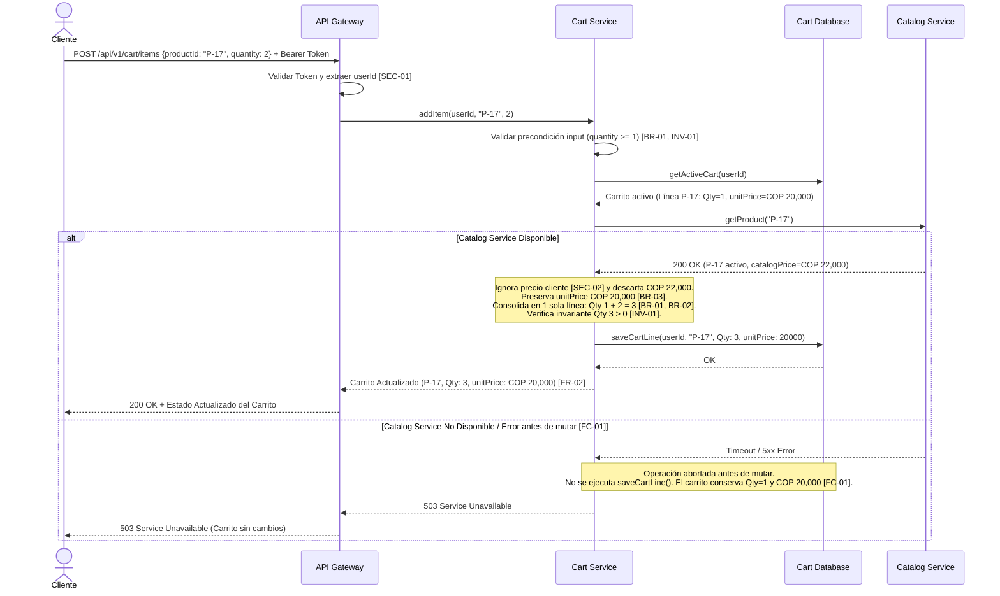

# AI Decision Log — Team Template
**Class 15 · Software Engineering I · UNAL 2026-II**[cite: 1]

## Submission metadata
- **Team / project:** UNAL-SPACE — Oscar Andrés Andrade Medina, Oscar David Ariza Rojas, David Fernando Ordoñez Pérez, Juan Sebastián Rodríguez León[cite: 5]
- **Review date:** 2026-10-20
- **AI tool and model (if known):** Google Gemini[cite: 4]
- **Baseline version / link:** `Class15_AI_Challenge_Guide_v1.md.pdf` (Version 1.0 — Part A Classroom Baseline)[cite: 1]
- **Selected artifact and version:** `01_Architectural_and_Detailed_Design.md` (Deliverable 1, v1.0 — Secciones 1, 3, 5, 6 y 7)[cite: 3, 5]
- **Sanitization check (no sensitive data shared):** Yes (Se verificó que el artefacto no contiene credenciales, tokens reales, datos personales de clientes ni endpoints privados institucionales)[cite: 3, 4]

---

## AI Interaction Record
| Step | Prompt or instruction (paste exact text or link) | AI response excerpt or link | What changed / why |
|---|---|---|---|
| **Initial (Part A)** | *"Contexto: Actúa como un Arquitecto de Software técnico. Estamos diseñando la mutación 'Add Product to Cart'. Escenario base: Un cliente autenticado con un carrito activo. El producto P-17 ya está en el carrito (Cantidad: 1, unitPrice acordado: COP 20,000). El cliente solicita añadir 2 unidades. El precio actual en Catálogo es COP 22,000. No hay concurrencia. Restricciones: [FR-01], [FR-02], [BR-01], [BR-02], [BR-03], [FC-01], [INV-01], [SEC-01], [SEC-02]. Salida Requerida: 1. Responsabilidades de Componentes citando reglas. 2. Contrato de Interfaz (addItem). 3. Diagrama Mermaid de secuencia. 4. Justificación y Trade-offs. 5. Preguntas Abiertas (Inventario, límites, expiración) sin integrarlas al diagrama ni al contrato."*[cite: 1, 2] | **Contrato:** `POST /api/v1/cart/items` con `{ "productId": "P-17", "quantity": 2 }` y Header `Authorization: Bearer <token>`. Omite `userId` `[SEC-01]` y `price` `[SEC-02]`. **Resultado 200 OK:** Línea única P-17 con `quantity: 3` y `unitPrice: 20000` `[BR-01, BR-02, BR-03, FR-02]`. **Fallo 400:** *"Si la cantidad resultante no es mayor a cero [INV-01]"*. **Secuencia:** Diagrama Mermaid lineal mostrando solo el caso exitoso. **Preguntas Abiertas:** Inventario, cantidad máxima y expiración aisladas correctamente. *(Ver Anexo A.1)*.[cite: 1, 2] | Generó una primera propuesta alineada con la mayoría de restricciones de seguridad y negocio, pero dejó dos brechas técnicas: (1) validó solo la cantidad resultante (`> 0`) permitiendo `quantity <= 0` en el payload de entrada, y (2) omitió la rama de fallo `[FC-01]` en el diagrama Mermaid.[cite: 1, 2, 3] |
| **Refinement (Part A)** | *"Cuestionamiento a la propuesta inicial: 1. En el contrato de interfaz (400 Bad Request), indicas que se valida que la 'cantidad resultante sea mayor a cero [INV-01]'. Sin embargo, si el cliente envía quantity: -1 o 0 en el input de addItem, violaría la semántica de incremento de [BR-01] o podría dejar el carrito en 0. Ajusta el contrato para validar estrictamente el input quantity >= 1 y proteger [BR-01] e [INV-01]. 2. Actualiza el diagrama Mermaid usando un bloque `alt / else` para modelar explícitamente el fallo exigido por [FC-01] cuando Catalog Service no está disponible antes de la mutación."*[cite: 1, 2, 3] | **Contrato Revisado:** Se exige `quantity >= 1` (entero positivo) en el payload de entrada; valores `<= 0` retornan `400 Bad Request` inmediatamente en el controlador antes de consultar BD o Catálogo, protegiendo `[BR-01]` e `[INV-01]`. **Diagrama Revisado:** Se incorporó bloque `alt Catalog Service Disponible / else Catalog Service No Disponible [FC-01]`, evidenciando que ante un error `5xx`/timeout del Catálogo no se invoca `saveCart()` y se retorna `503 Service Unavailable`. *(Ver Anexo A.2)*.[cite: 1, 2, 3] | Se cerró la brecha de validación de precondiciones en el contrato de interfaz y se garantizó la consistencia visual y técnica entre la regla `[FC-01]`, el contrato de errores (`503`) y el diagrama de secuencia.[cite: 2, 3] |
| **Project Review (Part B)** | *"Actúa como Arquitecto de Software revisor. Realiza una revisión enfocada de nuestro artefacto '01_Architectural_and_Detailed_Design.md' para el proyecto UNAL-SPACE (no reemplaces todo el diseño). Evalúa la consistencia entre los Design Drivers (DDR-01 a DDR-04), la Tabla de Responsabilidades, el seudocódigo de `MotorDisponibilidad.consultarEstadoActual(espacioId)` y la evaluación de calidad. Señala brechas, contradicciones o riesgos respaldados por evidencia y separa las preguntas abiertas."*[cite: 3, 5] | **Hallazgos IA:** 1. Contradicción entre la alta cohesión declarada en Sección 6 para `MotorDisponibilidad` y el seudocódigo de Sección 5 que ejecuta SQL directo (`PostgresSQL.ejecutar`). 2. El `Servicio de Notificación` se reporta con acoplamiento alto en Sección 6, pero falta en la Tabla de Responsabilidades y Matriz (Sección 3). 3. Sugiere usar caché para cumplir `DDR-03` (< 10 s) o índices en BD, pues el timeout del `API_GW` no acelera las consultas SQL en tiempo real. 4. Separa políticas de reserva como pregunta abierta.[cite: 5] | Permitió auditar nuestro entregable identificando dos defectos reales de trazabilidad y diseño detallado (`B1`, `B2`), una propuesta de caché que tuvimos que rechazar/modificar por contradecir `REQ-02` (`B3`) y una pregunta abierta (`B4`).[cite: 3, 5] |

---

## Part A — Common case: E-Commerce
| # | AI proposal / claim | Evidence checked (ID + artifact) | Decision (Accept / Modify / Reject / Clarify) | Engineering rationale | Residual risk / next action |
|---|---|---|---|---|---|
| **A1** | Omitir `userId` y `price` del payload de entrada de `addItem` (`POST /api/v1/cart/items`) y resolver la identidad del cliente exclusivamente a partir del token en el `API Gateway`. | **[SEC-01]**, **[SEC-02]** (`Class15_AI_Challenge_Guide_v1.md.pdf`, Part A Baseline)[cite: 1, 2] | **Accept**[cite: 3] | Es una decisión defensible y directamente respaldada por la evidencia: **[SEC-01]** prohíbe autorizar mediante un `userId` enviado por el cliente y **[SEC-02]** establece que cualquier precio del cliente no es confiable[cite: 2]. El contrato resultante `{ "productId": "P-17", "quantity": 2 }` cumple el principio de mínimo privilegio. | **Riesgo residual:** Si la comunicación interna entre `API Gateway` y `Cart Service` no está autenticada, un atacante en la red interna podría falsificar cabeceras. **Acción:** Propagar y verificar la firma del JWT internamente. |
| **A2** | Consultar `Catalog Service` antes de persistir el carrito, pero preservar el `unitPrice` acordado (`COP 20,000`) de la línea existente e incrementar la cantidad de `1` a `3` en una única línea. | **[FR-01]**, **[FR-02]**, **[BR-01]**, **[BR-02]**, **[BR-03]**, **[FC-01]** (`Class15_AI_Challenge_Guide_v1.md.pdf`, Part A Baseline)[cite: 1, 2] | **Accept**[cite: 3] | Verifica la disponibilidad de Catálogo antes de mutar el estado para cumplir **[FC-01]**[cite: 2], pero al detectar que `P-17` ya existe en el carrito activo, aplica **[BR-01]** y **[BR-02]** (suma `1 + 2 = 3` en una sola línea)[cite: 1] y respeta **[BR-03]** manteniendo `COP 20,000` en lugar de sobrescribirlo con los `COP 22,000` actuales del catálogo[cite: 1, 2]. | **Riesgo residual:** Dependencia síncrona con `Catalog Service` que penaliza la latencia y disponibilidad de `addItem`. **Acción:** Configurar *circuit breaker* y *timeout* estricto en el cliente HTTP hacia Catálogo. |
| **A3** | En la primera respuesta, validar en el `400 Bad Request` únicamente que la *"cantidad resultante en el carrito sea mayor a cero"*, sin restringir que el input `quantity` del request sea positivo, y mostrar solo el *Happy Path* en el diagrama Mermaid. | **[BR-01]**, **[INV-01]**, **[FC-01]** (`Class15_AI_Challenge_Guide_v1.md.pdf`, Part A Baseline)[cite: 1, 2] | **Modify**[cite: 3] | Validar solo el total resultante permitiría enviar `quantity: -1` (cuando hay 2 unidades) usando `addItem` para restar, lo que contradice **[BR-01]** (*"increases the existing cart-line quantity"*)[cite: 1]. Además, el diagrama omitía la ruta de fallo de **[FC-01]**[cite: 2]. Se refinó en el paso A4 exigiendo `quantity >= 1` en el payload y añadiendo el bloque `alt/else` en Mermaid. | **Riesgo residual:** Ninguno sobre `INV-01` para adiciones; sin embargo, falta definir el tope superior permitido por línea. **Acción:** Vincular con la pregunta abierta `A4` sobre límites máximos.[cite: 2] |
| **A4** | Aislar la validación de stock en Inventario, el límite máximo de unidades por producto/carrito y la política de expiración fuera del contrato y del diagrama de secuencia. | **Baseline: Not yet decided** (`Class15_AI_Challenge_Guide_v1.md.pdf`, p. 2)[cite: 2] | **Clarify**[cite: 3] | La guía establece explícitamente que la validación de inventario, la cantidad máxima permitida y la expiración del carrito aún no están decididas y no deben aprobarse silenciosamente[cite: 2]. Mantenerlas fuera del contrato evita introducir reglas de negocio no aprobadas. | **Riesgo residual:** Un usuario podría agregar 10,000 unidades sin stock real o retener el precio de `COP 20,000` indefinidamente. **Acción:** Elevar estas 3 preguntas abiertas al Product Owner antes de pasar a producción.[cite: 2] |

---

## Part B — Your project
| # | AI proposal / claim | Evidence checked (requirement or artifact reference) | Decision (Accept / Modify / Reject / Clarify) | Engineering rationale | Residual risk / next action |
|---|---|---|---|---|---|
| **B1** | Refactorizar `MotorDisponibilidad.consultarEstadoActual(espacioId)` para eliminar las consultas SQL directas (`PostgresSQL.ejecutar`) dentro del motor y delegar el acceso a datos a un Repositorio o a `Gestión Reservas`. | **DDR-01** (`REQ-02`), **Sección 4** (*Detailed Design*), **Sección 5** (*Key Operation Behavior*) y **Sección 6** (*Design Quality Evaluation — Cohesión*) en `01_Architectural_and_Detailed_Design.md`[cite: 5] | **Modify**[cite: 3] | La IA detectó una contradicción real en nuestro artefacto: en la Sección 6 justificamos que `MotorDisponibilidad` tiene **Alta Cohesión** porque *"posee únicamente la responsabilidad de validación temporal y cruce de franjas"*[cite: 5], pero en el seudocódigo de la Sección 5 le acoplamos sentencias SQL crudas (`SELECT id FROM reservas...`)[cite: 5]. Modificamos el diseño detallado introduciendo `ReservaRepository` para que el motor reciba entidades de dominio y solo ejecute lógica temporal. | **Riesgo residual:** Ligero aumento de clases/interfaces en el diagrama de clases detallado (Sección 4). **Acción:** Actualizar el seudocódigo de la Sección 5 y el diagrama de clases en la versión `v1.1` del entregable.[cite: 4, 5] |
| **B2** | Incluir formalmente el componente `Servicio de Notificación` en la Tabla de Responsabilidades y en la Matriz de Trazabilidad (Sección 3), y definir su manejo de errores para no bloquear la reserva. | **Sección 2** (*Architectural Design*), **Sección 3** (*Tabla de Responsabilidades / Matriz*) y **Sección 6** (*Acoplamiento Alto - Hallazgo*) en `01_Architectural_and_Detailed_Design.md`[cite: 5] | **Accept**[cite: 3] | En las Secciones 2 y 3 declaramos que `Gestión Reservas` depende de `Notificaciones`, y en la Sección 6 señalamos un alto acoplamiento síncrono con `Servicio de Notificación`[cite: 5], pero omitimos definir el componente en la Tabla de Responsabilidades y en la Matriz de Trazabilidad[cite: 5]. Aceptamos agregarlo a la Sección 3 y documentar un bloque `try/catch` *non-blocking* en `Gestión Reservas` para que un fallo SMTP no aborte la confirmación en BD. | **Riesgo residual:** Si el servicio de correo cae, la reserva quedará confirmada en `PostgresSQL` pero el estudiante no recibirá notificación inmediata. **Acción:** Registrar alerta en el log y evaluar cola asíncrona en iteraciones futuras.[cite: 5] |
| **B3** | Introducir una capa de caché para el estado de disponibilidad de los espacios con el fin de cumplir el tiempo de respuesta `< 10 segundos` bajo carga (`DDR-03`), ya que el `API_GW` solo corta por timeout pero no acelera la consulta SQL. | **DDR-01 / REQ-02** (Estado dinámico al momento de búsqueda), **DDR-03 / HU-002** (< 10 s bajo carga) y **Sección 7** (*ADR-01 y ADR-02*) en `01_Architectural_and_Detailed_Design.md`[cite: 5] | **Reject** *(con ajuste de indexación en BD)*[cite: 3] | Rechazamos implementar caché de estados porque viola directamente **DDR-01 (`REQ-02`)** y nuestro **ADR-02**, los cuales exigen precisión exacta al segundo de la búsqueda sin riesgo de datos obsoletos (*stale data*)[cite: 5]. Sin embargo, reconocemos la validez parcial de la crítica de la IA sobre `DDR-03`: el `API_GW` no optimiza la base de datos. Por tanto, mantenemos la consulta en tiempo real pero añadimos un índice compuesto `(espacio_id, estado, fechaInicio, fechaFin)` en `PostgresSQL`. | **Riesgo residual:** Bajo picos extremos de concurrencia, la base de datos relacional sigue recibiendo todas las lecturas. **Acción:** Incluir la definición del índice compuesto en el script DDL de `PostgresSQL` y medir tiempos con pruebas de carga.[cite: 5] |
| **B4** | Definir cómo se propaga la identidad del estudiante (`emailUnal` / `userId` desde el JWT validado en `Autenticación`) hacia `Gestión Reservas.crearReserva()` y cuáles son los límites de duración/anticipación de reservas. | **DDR-04** (*Restricción de Seguridad JWT*), **Sección 4** (*Exclusión del módulo de Políticas en MVP*) y **Sección 8** (*Open Questions*) en `01_Architectural_and_Detailed_Design.md`[cite: 5] | **Clarify**[cite: 3] | En la Sección 4 declaramos explícitamente que el módulo de *Políticas* se excluyó de este nivel de detalle para enfocarnos en el MVP de consulta y estado[cite: 5]. Al igual que en la Parte A, no debemos inventar reglas de negocio no aprobadas. Se documenta formalmente en la Sección 8 (*Open Questions*) para resolución con los stakeholders antes de implementar la mutación `crearReserva()`. | **Riesgo residual:** Si se expone `crearReserva()` sin cerrar estas preguntas, un usuario podría reservar espacios sin límite de horas o suplantar a otro usuario en el payload. **Acción:** Definir reglas de negocio de políticas y propagación de `userId` por token en el entregable 2.[cite: 2, 5] |

---

## Change record (only if a recommendation was accepted)
| Affected artifact | Previous version | Updated version | Linked decision ID | Reviewer / approval |
|---|---|---|---|---|
| `01_Architectural_and_Detailed_Design.md` — **Sección 3 (Tabla de Responsabilidades)**[cite: 5] | v1.0 (5 componentes listados; `Servicio de Notificación` aparecía como dependencia de `Gestión Reservas` pero no tenía fila propia en la tabla)[cite: 5]. | v1.1 (Se añade la fila del componente `Servicio de Notificación` con responsabilidad de envío de alertas por correo e interfaz *non-blocking* hacia `Gestión Reservas`). *(Ver Anexo B.1)*. | **B2** | Equipo UNAL-SPACE (Oscar Andrade, Oscar Ariza, David Ordoñez, Juan Rodríguez)[cite: 5] |
| `01_Architectural_and_Detailed_Design.md` — **Sección 5 (Key Operation Behavior)**[cite: 5] | v1.0 (`MotorDisponibilidad.consultarEstadoActual` invocaba directamente `PostgresSQL.ejecutar("SELECT...")` acoplando el motor al gestor SQL)[cite: 5]. | v1.1 (`MotorDisponibilidad` recibe el repositorio inyectado `reservaRepo.obtenerConfirmadasEnFecha(espacioId, horaActual)`, aislando el SQL fuera de la lógica matemática de horarios). *(Ver Anexo B.2)*. | **B1** | Equipo UNAL-SPACE (Oscar Andrade, Oscar Ariza, David Ordoñez, Juan Rodríguez)[cite: 5] |
| `01_Architectural_and_Detailed_Design.md` — **Sección 7 (ADR-02) y Sección 8 (Open Questions)**[cite: 5] | v1.0 (ADR-02 mencionaba consultas `BETWEEN` sin especificar optimización de índices para `DDR-03`; Sección 8 solo listaba la asunción de datos base)[cite: 5]. | v1.1 (ADR-02 incorpora el índice compuesto en `PostgresSQL` para respaldar `DDR-03` sin usar caché; Sección 8 registra las preguntas abiertas de propagación JWT y límites de políticas). *(Ver Anexo B.3)*. | **B3, B4** | Equipo UNAL-SPACE (Oscar Andrade, Oscar Ariza, David Ordoñez, Juan Rodríguez)[cite: 5] |

---

## Reflection (150–250 words)

**What did AI contribute?**
La IA aceleró la estructuración de artefactos trazables en la Parte A (mapeando reglas `[FR]`, `[BR]`, `[FC]` y `[SEC]` hacia componentes, contratos REST y secuencia en Mermaid) y actuó como un auditor de consistencia en la Parte B sobre nuestro proyecto **UNAL-SPACE**[cite: 1, 2, 5]. Su mayor valor fue detectar contradicciones internas en nuestro documento: evidenció que declarábamos alta cohesión matemática en `MotorDisponibilidad` (Sección 6) mientras su seudocódigo ejecutaba consultas SQL crudas (Sección 5), y que omitíamos al `Servicio de Notificación` en la Tabla de Responsabilidades pese a evaluarlo en los riesgos de acoplamiento[cite: 5].

**What required independent verification?**
Requirió verificación humana contrastar cada propuesta contra las reglas aprobadas y nuestros *Design Drivers*[cite: 3, 4, 5]. En la Parte A, detectamos que la primera respuesta validaba solo la cantidad resultante (`> 0`), lo que habría permitido enviar cantidades negativas en `addItem`, y que el diagrama omitía la rama de fallo `[FC-01]`[cite: 1, 2]. En la Parte B, rechazamos la sugerencia de introducir caché para cumplir `DDR-03` (`< 10 s`), pues violaba el requisito `REQ-02` de mostrar disponibilidad exacta en tiempo real[cite: 5].

**What would your team do differently next time?**
En futuras iteraciones exigiremos desde el primer prompt que los diagramas de secuencia incluyan bloques `alt/else` para las rutas de excepción y verificaremos que ningún componente de dominio incluya llamadas directas a base de datos antes de declarar alta cohesión[cite: 2, 5]. *(224 palabras)*.

---

## Final checks
- [x] Every accepted change is supported by approved requirements or an explicitly approved new decision.[cite: 1, 3, 5]
- [x] Unconfirmed business rules are recorded as open questions, not approved requirements.[cite: 2, 3, 5]
- [x] Interface contracts, sequence diagrams and data models are consistent where they overlap.[cite: 2, 3]
- [x] Relevant preconditions, postconditions, failure behavior and invariants are considered.[cite: 2, 3]
- [x] No confidential or personal information was sent to an unauthorized external AI service.[cite: 3, 4]
- [x] The team can explain and defend every accepted design decision.[cite: 1, 4]

---

## Anexos de Evidencia y Artefactos Actualizados (Trazabilidad Completa)[cite: 4]

### Anexo A.1 — Primera Respuesta de la IA (Parte A - Extracto Relevante)[cite: 4]
* **Responsabilidades de Componentes:**
  * **API Gateway / Auth Middleware:** Intercepta la petición, valida el token y extrae el `userId` de la identidad autenticada `[SEC-01]`[cite: 2].
  * **Cart Service:** Permite añadir productos al carrito activo `[FR-01]`, ignora precios del cliente `[SEC-02]`, suma la cantidad a la línea existente `[BR-01]` manteniendo máximo una línea por producto `[BR-02]`, preserva el `unitPrice` acordado de `COP 20,000` `[BR-03]`, verifica cantidad persistida `> 0` `[INV-01]`, aborta sin mutar si Catálogo falla antes de la mutación `[FC-01]` y retorna el carrito actualizado `[FR-02]`[cite: 1, 2].
  * **Catalog Service:** Provee la información vigente del producto (`COP 22,000`) como dependencia previa a la mutación `[FC-01]`[cite: 1, 2].
* **Contrato Inicial (`addItem`):** `POST /api/v1/cart/items` | Payload: `{ "productId": "P-17", "quantity": 2 }`. Respuestas: `200 OK` (P-17, `quantity: 3`, `unitPrice: 20000`), `400 Bad Request` (si la cantidad resultante no es `> 0`), `401 Unauthorized` (`[SEC-01]`), `503 Service Unavailable` (`[FC-01]`)[cite: 1, 2].

### Anexo A.2 — Respuesta Revisada tras Refinamiento (Parte A - Contrato y Mermaid Final)[cite: 3, 4]
* **Precondición Corregida en Contrato (`400 Bad Request`):** Se valida en la frontera de entrada que `quantity` sea un entero estrictamente positivo (`quantity >= 1`). Valores `<= 0` se rechazan inmediatamente con `400 Bad Request` para cumplir `[BR-01]` (incremento) y proteger la invariante `[INV-01]` (`quantity > 0`)[cite: 1, 2].
* **Diagrama de Secuencia Revisado (con bloque `alt / else` para `[FC-01]`):**



* **Preguntas Abiertas (No decididas — fuera del contrato y del diagrama):**[cite: 2]
  1. *Validación de Inventario:* ¿En qué momento (`addItem` vs. `checkout`) debe consultarse el servicio de Inventario para validar stock disponible?[cite: 2]
  2. *Límites de Cantidad:* ¿Existe una cantidad máxima permitida por línea de producto o por carrito total?[cite: 2]
  3. *Política de Expiración:* ¿Cuánto tiempo permanece activo un carrito y por cuánto tiempo se respeta el `unitPrice` histórico (`COP 20,000`) frente a subidas en el catálogo?[cite: 2]

---

### Anexo B — Cambios Aplicados al Artefacto del Proyecto (`01_Architectural_and_Detailed_Design.md` v1.0 $\rightarrow$ v1.1)[cite: 4, 5]

#### B.1 Actualización en Sección 3 (Tabla de Responsabilidades — Decisión `B2`)
```markdown
| Componente | Responsabilidad Principal | Capacidades Proporcionadas | Dependencias Requeridas |
|---|---|---|---|
| **Servicio de Notificación** | Gestionar el envío de correos de confirmación de reserva de forma desacoplada (*non-blocking*). | Envío de notificaciones SMTP / alertas al correo `@unal.edu.co` sin abortar la transacción principal en caso de fallo. | Servidor SMTP Externo |
```

#### B.2 Actualización en Sección 5 (Key Operation Behavior — Decisión `B1`)
```text
INICIO consultarEstadoActual(espacioId)
    intentar:
        // 1. Validar precondición a través del Repositorio (Desacoplado de SQL directo)
        espacio = espacioRepository.buscarPorId(espacioId)
        si espacio es NULO:
            retornar EstadoDisponibilidad.NO_REGISTRADO
            
        // 2. Obtener reservas activas mediante abstracción de persistencia
        horaActual = DateTime.now()
        reservasActivas = reservaRepository.obtenerConfirmadasEnFranja(espacioId, horaActual)
        
        // 3. Evaluar cruce (Alta cohesión: solo lógica de dominio temporal)
        si reservasActivas.tieneRegistros():
            retornar EstadoDisponibilidad.OCUPADO
        sino:
            retornar EstadoDisponibilidad.DISPONIBLE
            
    capturar ErrorDeRepositorio:
        // Ruta de excepción obligatoria documentada en HU-002
        registrarLog("Error de timeout al consultar persistencia desde repositorio")
        lanzar Excepcion("Fallo de conexión. No se pudo cargar el estado de disponibilidad.") // Manejado por API_GW
FIN
```

#### B.3 Actualización en Sección 7 y 8 (ADR-02 y Open Questions — Decisiones `B3` y `B4`)
* **Adición en ADR-02 (Mitigación de rendimiento sin violar tiempo real):** *"Para garantizar que el cruce `BETWEEN fechaInicio AND fechaFin` cumpla con `DDR-03` (< 10 segundos bajo carga) sin introducir caché que comprometa la exactitud en tiempo real de `REQ-02`, se define un índice compuesto `idx_reservas_disponibilidad (espacio_id, estado, fechaInicio, fechaFin)` en `PostgresSQL`."*[cite: 5]
* **Adición en Sección 8 (Open Questions):**
  1. *Propagación de Identidad Segura (`DDR-04`):* Definir el contrato interno mediante el cual el `API_GW` inyecta el `userId` / `emailUnal` extraído del token JWT hacia `Gestión Reservas`, garantizando que el cliente web no pueda enviar un `userId` arbitrario en el cuerpo de la petición.[cite: 2, 5]
  2. *Políticas de Reserva (Fuera del MVP):* Definir con los stakeholders la duración máxima por reserva, el número máximo de reservas activas por estudiante y la ventana de anticipación permitida.[cite: 5]
