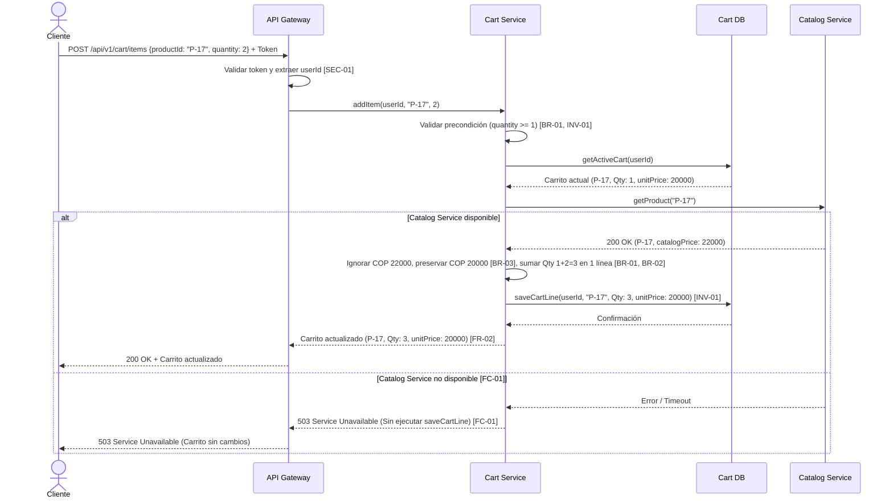

# AI Decision Log — Team Template
**Class 15 · Software Engineering I · UNAL 2026-II**

## Submission metadata
- Team / project: UNAL-SPACE — Oscar Andrés Andrade Medina, Oscar David Ariza Rojas, David Fernando Ordoñez Pérez, Juan Sebastián Rodríguez León
- Review date: 2026-10-20
- AI tool and model (if known): Google Gemini
- Baseline version / link: Class15_AI_Challenge_Guide_v1.md.pdf (Version 1.0)
- Selected artifact and version: 01_Architectural_and_Detailed_Design.md (v1.0)
- Sanitization check (no sensitive data shared): Yes

## AI Interaction Record
| Step | Prompt or instruction (paste exact text or link) | AI response excerpt or link | What changed / why |
|---|---|---|---|
| Initial | Contexto: Actúa como un Arquitecto de Software técnico. Estamos diseñando la mutación "Add Product to Cart". Escenario base: Un cliente autenticado con un carrito activo. El producto P-17 ya está en el carrito (Cantidad: 1, unitPrice acordado: COP 20,000). El cliente solicita añadir 2 unidades. El precio actual en Catálogo es COP 22,000. No hay concurrencia. Restricciones: [FR-01], [FR-02], [BR-01], [BR-02], [BR-03], [FC-01], [INV-01], [SEC-01], [SEC-02]. Salida Requerida: 1. Responsabilidades de Componentes. 2. Contrato de Interfaz (addItem). 3. Diagrama Mermaid. 4. Justificación y Trade-offs. 5. Preguntas Abiertas. | Contrato: POST /api/v1/cart/items con { "productId": "P-17", "quantity": 2 } y Header Authorization: Bearer <token>. Omite userId [SEC-01] y price [SEC-02]. Respuesta 200 OK: Línea única P-17 con quantity: 3 y unitPrice: 20000 [BR-01, BR-02, BR-03, FR-02]. Error 400: Si la cantidad resultante no es mayor a cero [INV-01]. Diagrama Mermaid lineal mostrando solo el caso exitoso. Preguntas abiertas separadas. | Generó una propuesta alineada con las reglas de negocio y seguridad, pero dejó dos brechas: validó solo la cantidad resultante (> 0) permitiendo cantidades negativas en el payload de entrada, y omitió la rama de fallo [FC-01] en el diagrama de secuencia. |
| Refinement | 1. En el contrato (400 Bad Request), indicas que se valida que la cantidad resultante sea mayor a cero [INV-01]. Si el cliente envía quantity: -1 o 0 en el input de addItem, violaría la semántica de incremento de [BR-01]. Ajusta el contrato para validar estrictamente el input quantity >= 1. 2. Actualiza el diagrama Mermaid usando un bloque alt / else para modelar explícitamente el fallo exigido por [FC-01] cuando Catalog Service falla antes de la mutación. Search: Realizar revisión enfocada de 01_Architectural_and_Detailed_Design.md (UNAL-SPACE) contrastando DDR-01 a DDR-04, Tabla de Responsabilidades, seudocódigo y calidad. | Parte A: Se exige quantity >= 1 en el payload de entrada; valores <= 0 retornan 400 Bad Request antes de consultar BD o Catálogo. Se añadió bloque alt/else en Mermaid mostrando que ante error 5xx de Catálogo no se invoca saveCart() y se retorna 503. Parte B: Identificó SQL directo en MotorDisponibilidad contradiciendo su cohesión (Sección 5 vs 6), omisión de Servicio de Notificación en Sección 3, y sugirió caché o índices para DDR-03. | En Parte A se corrigió la precondición del contrato y la consistencia del diagrama con [FC-01]. En Parte B permitió identificar dos defectos de diseño/trazabilidad (B1, B2), rechazar el uso de caché por contradecir REQ-02 (B3) y documentar preguntas abiertas (B4). |

## Part A — Common case: E-Commerce
| # | AI proposal / claim | Evidence checked (ID + artifact) | Decision (Accept / Modify / Reject / Clarify) | Engineering rationale | Residual risk / next action |
|---|---|---|---|---|---|
| A1 | Omitir userId y price del payload de entrada de addItem y extraer la identidad exclusivamente del token en el API Gateway. | SEC-01, SEC-02 (Class15_AI_Challenge_Guide_v1.md.pdf) | Accept | SEC-01 prohíbe autorizar mediante un userId enviado por el cliente y SEC-02 establece que el precio del cliente no es confiable. El payload { "productId": "P-17", "quantity": 2 } previene suplantación de identidad y manipulación de precios. | Riesgo: Comunicación interna no autenticada entre Gateway y Cart Service. Acción: Validar firma del token JWT o usar mTLS en la red interna. |
| A2 | Consultar Catalog Service antes de persistir el carrito, preservar el unitPrice acordado (COP 20,000) de la línea existente e incrementar la cantidad de 1 a 3 en una única línea. | FR-01, FR-02, BR-01, BR-02, BR-03, FC-01 (Class15_AI_Challenge_Guide_v1.md.pdf) | Accept | Verifica disponibilidad de Catálogo antes de mutar (FC-01), consolida en una sola línea sumando 1 + 2 = 3 (BR-01, BR-02), mantiene el precio histórico de COP 20,000 ignorando los COP 22,000 actuales (BR-03) y devuelve el carrito actualizado (FR-02). | Riesgo: Dependencia síncrona con Catalog Service afecta latencia y disponibilidad de addItem. Acción: Definir timeout estricto en el cliente HTTP. |
| A3 | Validar únicamente que la cantidad resultante sea mayor a cero (400 Bad Request) y representar solo el flujo exitoso en el diagrama de secuencia. | BR-01, INV-01, FC-01 (Class15_AI_Challenge_Guide_v1.md.pdf) | Modify | Validar solo el total resultante permitiría enviar quantity: -1 (cuando hay 2 unidades) para restar ítems en addItem, contradiciendo BR-01. Se modificó el contrato para exigir quantity >= 1 en la entrada y se agregó un bloque alt/else en el diagrama para modelar FC-01. | Riesgo: Falta límite superior de unidades por línea. Acción: Resolver junto con las preguntas abiertas de negocio. |
| A4 | Mantener la validación de inventario, el límite máximo de cantidad y la expiración del carrito fuera del contrato y del diagrama de secuencia. | Baseline: Not yet decided (Class15_AI_Challenge_Guide_v1.md.pdf) | Clarify | El baseline indica explícitamente que estas tres políticas no están decididas y deben tratarse como preguntas abiertas sin aprobarse silenciosamente. | Riesgo: Usuarios podrían agregar cantidades sin stock físico o retener precios antiguos indefinidamente. Acción: Solicitar definición al Product Owner. |

## Part B — Your project
| # | AI proposal / claim | Evidence checked (requirement or artifact reference) | Decision (Accept / Modify / Reject / Clarify) | Engineering rationale | Residual risk / next action |
|---|---|---|---|---|---|
| B1 | Refactorizar MotorDisponibilidad.consultarEstadoActual(espacioId) para eliminar las consultas SQL directas (PostgresSQL.ejecutar) y delegar el acceso a datos a un repositorio. | DDR-01 (REQ-02), Sección 5 y Sección 6 en 01_Architectural_and_Detailed_Design.md | Modify | En la Sección 6 declaramos alta cohesión en MotorDisponibilidad indicando que solo realiza cálculo temporal, pero en el seudocódigo de la Sección 5 ejecutábamos consultas SQL directas. Se modifica la Sección 5 para inyectar un repositorio de reservas y mantener la cohesión del motor. | Riesgo: Incremento de interfaces en el diseño detallado. Acción: Actualizar el seudocódigo de la Sección 5 y el diagrama de clases. |
| B2 | Agregar el Servicio de Notificación en la Tabla de Responsabilidades y Matriz de Trazabilidad (Sección 3), y manejar sus fallos como no bloqueantes. | Sección 2, Sección 3 y Sección 6 en 01_Architectural_and_Detailed_Design.md | Accept | En la Sección 6 se evalúa el acoplamiento con el Servicio de Notificación y en la Sección 3 se lista como dependencia de Gestión Reservas, pero el componente no tenía fila propia en la Tabla de Responsabilidades. Se añade a la Sección 3 indicando manejo de errores no bloqueante. | Riesgo: Si el servidor de correo falla, la reserva se confirma en BD pero el usuario no recibe correo. Acción: Registrar fallo en log y evaluar cola asíncrona a futuro. |
| B3 | Introducir una caché de lectura para el estado de disponibilidad con el fin de cumplir el tiempo de respuesta menor a 10 segundos bajo carga (DDR-03). | DDR-01 (REQ-02), DDR-03 (HU-002) y Sección 7 (ADR-01, ADR-02) en 01_Architectural_and_Detailed_Design.md | Reject | Se rechaza el uso de caché porque contradice DDR-01 (REQ-02) y el ADR-02, que exigen consultar la disponibilidad exacta en tiempo real al momento de la búsqueda. Para mitigar la carga sobre la BD señalada por la IA, se opta por un índice compuesto en PostgresSQL sin usar caché. | Riesgo: La base de datos relacional sigue recibiendo todas las lecturas concurrentes. Acción: Añadir índice compuesto (espacio_id, estado, fechaInicio, fechaFin) en BD. |
| B4 | Definir la propagación del userId desde el token JWT hacia Gestión Reservas y las políticas de límite de duración por reserva. | DDR-04, Sección 4 y Sección 8 en 01_Architectural_and_Detailed_Design.md | Clarify | La Sección 4 excluye explícitamente el módulo de Políticas del alcance del MVP. Siguiendo el método de no inventar reglas no aprobadas, se registra en la Sección 8 (Open Questions) para definición previa a la implementación de crearReserva(). | Riesgo: Reservas sin límite de duración si se habilita la creación sin estas reglas. Acción: Definir políticas con los stakeholders en la siguiente iteración. |

## Change record (only if a recommendation was accepted)
| Affected artifact | Previous version | Updated version | Linked decision ID | Reviewer / approval |
|---|---|---|---|---|
| 01_Architectural_and_Detailed_Design.md (Sección 3) | v1.0: Servicio de Notificación ausente como fila en la Tabla de Responsabilidades. | v1.1: Se agrega fila para Servicio de Notificación en la Tabla de Responsabilidades con comportamiento no bloqueante. | B2 | Equipo UNAL-SPACE |
| 01_Architectural_and_Detailed_Design.md (Sección 5) | v1.0: MotorDisponibilidad.consultarEstadoActual ejecutaba PostgresSQL.ejecutar() directamente. | v1.1: Se reemplazan las llamadas SQL directas por llamadas a espacioRepository y reservaRepository. | B1 | Equipo UNAL-SPACE |
| 01_Architectural_and_Detailed_Design.md (Secciones 7 y 8) | v1.0: ADR-02 sin especificación de índices; Sección 8 solo con asunción de datos base. | v1.1: Se documenta índice compuesto en ADR-02 para soportar DDR-03 y se agregan preguntas abiertas sobre JWT y políticas en Sección 8. | B3, B4 | Equipo UNAL-SPACE |

## Reflection (150–250 words)
**What did AI contribute?**
La IA agilizó la generación de artefactos trazables en la Parte A (conectando reglas FR, BR, FC y SEC con componentes, contrato REST y diagrama de secuencia) y funcionó como auditor de consistencia sobre nuestro diseño de UNAL-SPACE en la Parte B. Su aporte principal fue identificar contradicciones internas en nuestro documento: detectó que declarábamos alta cohesión en MotorDisponibilidad (Sección 6) mientras su seudocódigo ejecutaba consultas SQL crudas (Sección 5), y que omitíamos al Servicio de Notificación en la Tabla de Responsabilidades pese a evaluarlo en la sección de acoplamiento.

**What required independent verification?**
Fue necesario verificar manualmente cada propuesta frente al baseline aprobado y los Design Drivers del proyecto. En la Parte A, detectamos que la primera respuesta validaba solo que la cantidad resultante fuera mayor a cero, lo que permitía enviar cantidades negativas en el payload de addItem, además de omitir el flujo alternativo para FC-01 en el diagrama. En la Parte B, rechazamos la sugerencia de implementar caché para cumplir DDR-03 (< 10 segundos), porque violaba el requisito REQ-02 de mostrar disponibilidad en tiempo real.

**What would your team do differently next time?**
En próximas iteraciones solicitaremos desde el primer prompt que los diagramas incluyan bloques condicionales para las rutas de fallo y revisaremos que ningún componente de dominio contenga llamadas directas a base de datos antes de documentar su cohesión.

## Final checks
- [x] Every accepted change is supported by approved requirements or an explicitly approved new decision.
- [x] Unconfirmed business rules are recorded as open questions, not approved requirements.
- [x] Interface contracts, sequence diagrams and data models are consistent where they overlap.
- [x] Relevant preconditions, postconditions, failure behavior and invariants are considered.
- [x] No confidential or personal information was sent to an unauthorized external AI service.
- [x] The team can explain and defend every accepted design decision.

---

## Appendix A — Part A Final Artifacts

### 1. Component Responsibilities
- API Gateway / Auth Middleware: Validar el token de autenticación y extraer la identidad del cliente sin confiar en ningún userId enviado en el cuerpo de la petición [SEC-01].
- Cart Service: Permitir añadir productos al carrito activo [FR-01], validar que la cantidad de entrada sea entera positiva (>= 1) [BR-01, INV-01], ignorar precios enviados por el cliente [SEC-02], verificar disponibilidad de Catalog Service antes de mutar garantizando que el carrito no cambie si este falla [FC-01], incrementar la cantidad en la única línea existente del producto [BR-01, BR-02], conservar el unitPrice acordado de COP 20,000 [BR-03] y retornar el estado actualizado del carrito [FR-02].
- Catalog Service: Proveer el estado y precio vigente del producto (COP 22,000) como verificación previa a la mutación [FC-01].

### 2. Interface Contract (addItem)
- Endpoint: POST /api/v1/cart/items
- Headers: Authorization: Bearer <token> [SEC-01]
- Request Payload (omite userId [SEC-01] y price [SEC-02]):
```json
{
  "productId": "P-17",
  "quantity": 2
}
```
- Preconditions: Token válido perteneciente a un cliente con carrito activo [FR-01, SEC-01]; productId no vacío; quantity entero >= 1 [BR-01, INV-01].
- Outcomes & Error Behavior:
  - 200 OK: Retorna el carrito actualizado con una sola línea para P-17, quantity: 3 y unitPrice: 20000 [FR-02, BR-01, BR-02, BR-03, INV-01].
  - 400 Bad Request: Si quantity <= 0 o formato inválido, se rechaza sin mutar el carrito [BR-01, INV-01].
  - 401 Unauthorized: Si el token es inválido o ausente [SEC-01].
  - 503 Service Unavailable: Si Catalog Service falla o no responde antes de la mutación, se aborta la operación y el carrito permanece sin cambios (P-17 con quantity: 1 y unitPrice: 20000) [FC-01].

### 3. Sequence Diagram (Mermaid)


### 4. Open Questions (Part A)
- Validación de inventario: Definir si la disponibilidad de stock debe validarse al ejecutar addItem o únicamente durante el checkout.
- Límites de cantidad: Definir la cantidad máxima permitida por línea de producto y por carrito.
- Política de expiración: Definir el tiempo de expiración de un carrito activo y la vigencia del unitPrice congelado en la línea.

---

## Appendix B — Part B Updated Artifact Excerpts (UNAL-SPACE v1.1)

### 1. Sección 3 Actualizada (Adición de Servicio de Notificación — Decisión B2)
| Componente | Responsabilidad Principal | Capacidades Proporcionadas | Dependencias Requeridas |
|---|---|---|---|
| Servicio de Notificación | Enviar confirmaciones de reserva por correo institucional sin bloquear la transacción principal. | Envío de alertas SMTP ante creación de reservas. | Servidor SMTP Externo |

### 2. Sección 5 Actualizada (Seudocódigo desacoplado de SQL — Decisión B1)
```text
INICIO consultarEstadoActual(espacioId)
    intentar:
        espacio = espacioRepository.buscarPorId(espacioId)
        si espacio es NULO:
            retornar EstadoDisponibilidad.NO_REGISTRADO
            
        horaActual = DateTime.now()
        reservasActivas = reservaRepository.obtenerConfirmadasEnFranja(espacioId, horaActual)
        
        si reservasActivas.tieneRegistros():
            retornar EstadoDisponibilidad.OCUPADO
        sino:
            retornar EstadoDisponibilidad.DISPONIBLE
            
    capturar ErrorDeRepositorio:
        registrarLog("Error de timeout al consultar persistencia desde repositorio")
        lanzar Excepcion("Fallo de conexión. No se pudo cargar el estado de disponibilidad.")
FIN
```
