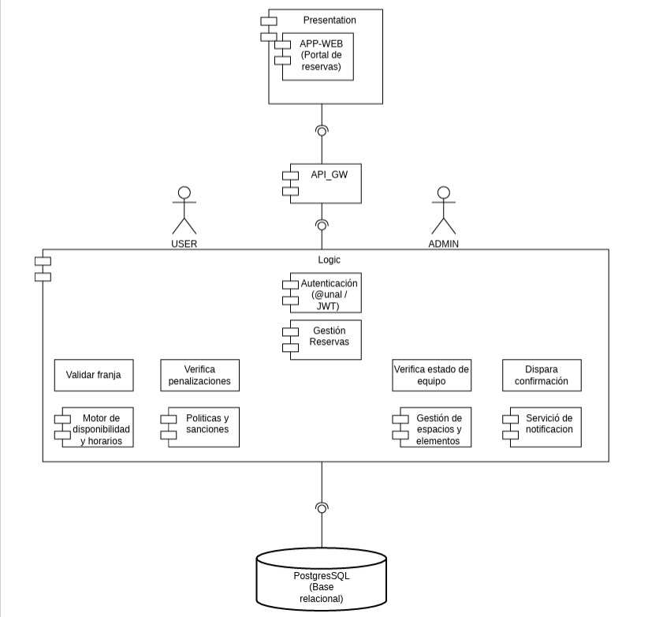
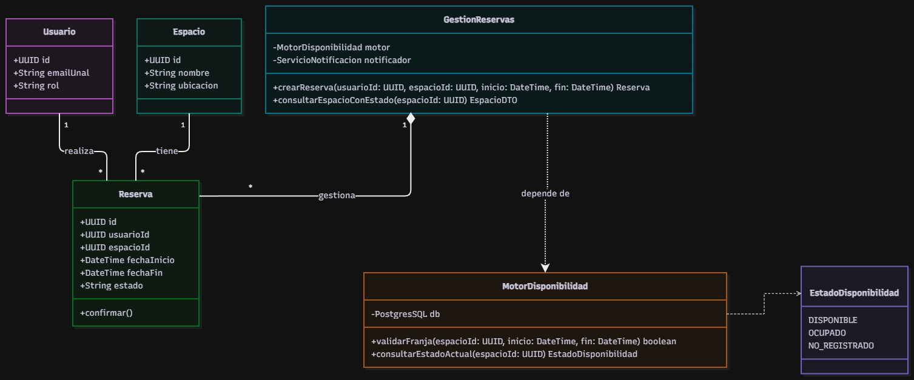

# Design Deliverable 1: Architectural and Detailed Design

**Project Name:** UNAL-SPACE  
**Team Members:** Oscar Andres Andrade Medina, Oscar David Ariza Rojas, David Fernando Ordoñez Pérez, Juan Sebastián Rodríguez León

## 1. Design Drivers
| ID | Descripción | Tipo | Fuente | Consecuencia para el diseño |
|---|---|---|---|---|
| **DDR-01** | Consulta del estado de disponibilidad al momento de la búsqueda. | Funcional | REQ-02 | Obliga la creación de un `Motor de disponibilidad y horarios` para validar franjas en tiempo real. |
| **DDR-02** | Consulta de detalle, imagen y ubicación de espacios. | Funcional | REQ-01 | La base de datos central debe centralizar los atributos físicos y devolverlos integrados. |
| **DDR-03** | Tiempo de respuesta del backend y renderizado < 10 segundos bajo carga. | Restricción de Calidad | HU-002 | Introducción de un `API_GW` para gestionar timeouts de red e interrupciones de forma centralizada. |
| **DDR-04** | Acceso exclusivo para usuarios de la universidad. | Restricción de Seguridad | Diagrama Base | Uso del componente `Autenticación (@unal / JWT)` integrado desde el Gateway. |

## 2. Architectural Design
La arquitectura sigue un patrón de diseño por capas centralizado en un API Gateway, priorizando el enrutamiento seguro y la orquestación. Por directriz del equipo docente, el diagrama arquitectónico de componentes se adjunta como imagen, representando fielmente los módulos seleccionados.



**Justificación:** 
El Gateway enruta peticiones hacia componentes altamente cohesivos en la Capa Lógica. La lógica principal recae en el orquestador `Gestión Reservas`, que a su vez se apoya en componentes especializados de cálculo temporal (`Motor de disponibilidad`) y asincronía (`Servicio de notificación`). La persistencia se unifica en una capa de datos relacional (`PostgresSQL`).

## 3. Responsibilities and Traceability

### Tabla de Responsabilidades
| Componente | Responsabilidad Principal | Capacidades Proporcionadas | Dependencias Requeridas |
|---|---|---|---|
| **APP-WEB** | Renderizar UI, listados e invocar API. | Interfaz de búsqueda y detalle de espacios. | API_GW |
| **API_GW** | Enrutamiento y control de fallos/timeouts. | Resolución de peticiones, emisión de alertas de red. | Capa Lógica |
| **Autenticación** | Validar identidad institucional. | Emisión y validación de tokens JWT. | PostgresSQL |
| **Gestión Reservas** | Orquestar creación y consulta de reservas. | Creación y lectura consolidada de reservas y espacios. | Motor de Disponibilidad, Notificaciones, BD |
| **Motor de disponibilidad**| Calcular cruces horarios de espacios. | Retorno de estado dinámico (Disponible/Ocupado). | PostgresSQL |

### Matriz de Trazabilidad Requisito-Componente
| Requisito / Fuente | APP-WEB | API_GW | Autenticación | Gestión Reservas | Motor de Disponibilidad |
|---|:---:|:---:|:---:|:---:|:---:|
| **REQ-01:** Detalles del espacio | X | X | | X | |
| **REQ-02:** Estado dinámico | X | X | | | X |
| **HU-002:** Timeout y conexión | X | X | | | |
| **Diagrama Base:** Restricción | | X | X | | |

## 4. Detailed Design

Se seleccionan los componentes `Gestión Reservas` y `Motor de disponibilidad y horarios` por concentrar el alcance funcional principal de las búsquedas y estados. Los módulos de *Políticas* y *Gestión de espacios* se excluyen de este nivel de detalle para centrarse en el MVP. Por directriz docente, el diagrama se adjunta como imagen.



**Elementos representados en el diseño:**
*   **Entidades base:** `Usuario` (id, emailUnal, rol) y `Espacio` (id, nombre, ubicacion).
*   **Gestión Reservas:** Clase orquestadora con operaciones para `crearReserva()` y `consultarEspacioConEstado()`. Tiene una relación de dependencia hacia el Motor de Disponibilidad.
*   **MotorDisponibilidad:** Contiene la lógica interna `validarFranja()` y `consultarEstadoActual()`. Retorna valores de la enumeración `EstadoDisponibilidad` (DISPONIBLE, OCUPADO, NO_REGISTRADO).
*   **Reserva:** Entidad que agrupa al Usuario, al Espacio y las fechas (inicio/fin), ocultando la lógica de cambio de estado en el método `confirmar()`.

## 5. Key Operation Behavior

**Operación:** `MotorDisponibilidad.consultarEstadoActual(espacioId)`  
**Requisito soportado:** REQ-02 (Cálculo de disponibilidad al momento de búsqueda).

```text
INICIO consultarEstadoActual(espacioId)
    intentar:
        // 1. Validar precondición
        espacio = PostgresSQL.ejecutar("SELECT id FROM espacios WHERE id = ?", espacioId)
        si espacio es NULO:
            retornar EstadoDisponibilidad.NO_REGISTRADO
            
        // 2. Ejecutar cálculo basado en la hora actual del sistema
        horaActual = DateTime.now()
        
        reservasActivas = PostgresSQL.ejecutar(
            "SELECT id FROM reservas 
             WHERE espacio_id = ? 
             AND estado = 'CONFIRMADA' 
             AND ? BETWEEN fechaInicio AND fechaFin", 
             espacioId, horaActual
        )
        
        // 3. Evaluar cruce
        si reservasActivas.tieneRegistros():
            retornar EstadoDisponibilidad.OCUPADO
        sino:
            retornar EstadoDisponibilidad.DISPONIBLE
            
    capturar ErrorDeConexionBD:
        // Ruta de excepción obligatoria documentada en HU-002
        registrarLog("Error de timeout al consultar base de datos en Motor")
        lanzar Excepcion("Fallo de conexión. No se pudo cargar el estado de disponibilidad.") // Manejado por API_GW
FIN


    reservas ..> motor : Usa para validar franja
    reservas ..> notif : Dispara confirmación
    
    auth --> db
    reservas --> db
    motor --> db


## 6. Design Quality Evaluation
| Propiedad | Elemento | Evidencia del Diseño | Consecuencia / Justificación |
|---|---|---|---|
| **Cohesión (Alta)** | `MotorDisponibilidad` | Posee únicamente la responsabilidad de validación temporal y cruce de franjas, sin manejar bases de datos externas de usuarios. | Facilita el mantenimiento. Separa la lógica matemática y de horarios del gestor principal de la aplicación. |
| **Acoplamiento (Alto - Hallazgo)** | `Gestión Reservas` | Tiene una dependencia sincrónica y directa con el componente `Servicio de Notificación`. | Si el servidor de correos falla, la reserva podría quedar bloqueada o lanzar timeout. **Mejora sugerida:** Implementar colas de eventos asíncronos a futuro. |
| **Ocultamiento de información** | `Reserva` (Clase) | Atributos internos ocultos; los cambios del ciclo de vida se gestionan internamente mediante el método `confirmar()`. | Evita que componentes externos alteren arbitrariamente los estados en la base de datos eludiendo reglas de negocio. |

## 7. Justified Decisions & ADRs

**1. Decisión Arquitectónica: Uso de un API Gateway**
* **Because [context]:** El sistema debe manejar múltiples peticiones garantizando tiempos de respuesta menores a 10 segundos (HU-002), y necesitamos un punto centralizado para gestionar las caídas de red o timeouts antes de que lleguen a la lógica core.
* **We chose [decision]:** Introducir un componente `API_GW` como intermediario entre la `APP-WEB` y la Capa Lógica.
* **Accepting [trade-off]:** El costo de mantener un componente de red adicional que agrega un ligero salto de latencia, a cambio de centralizar el enrutamiento seguro y la emisión de alertas tempranas de error de conexión.

**2. Decisión de Diseño Detallado: Cálculo dinámico de disponibilidad**
* **Because [context]:** El requerimiento REQ-02 exige mostrar el estado ("Disponible" u "Ocupado") exactamente al momento de realizar la búsqueda, lo cual representa un alto riesgo de desactualización si se maneja como un atributo estático en la tabla de espacios.
* **We chose [decision]:** Delegar el cálculo del estado temporal al componente `Motor de disponibilidad y horarios`, el cual cruza en tiempo real el timestamp actual con las fechas de las reservas confirmadas en base de datos.
* **Accepting [trade-off]:** El costo de realizar consultas relacionales (operaciones JOIN y BETWEEN) adicionales bajo demanda, a cambio de garantizar la precisión de la información de disponibilidad al segundo exacto de la búsqueda.

**Reference:** `docs/decisions/ADR-001-calculo-disponibilidad-tiempo-real.md`

## 8. Open Questions & Assumptions
*   **Asunción (Datos Base):** Asumimos que las entidades base (Espacios con sus imágenes y ubicaciones) y los usuarios ya han sido inyectados en la base de datos mediante el componente `Gestión de espacios y elementos` (fuera del alcance de este MVP) o un proceso de migración, permitiéndonos centrar este diseño en el flujo de consulta y reserva del estudiante.
