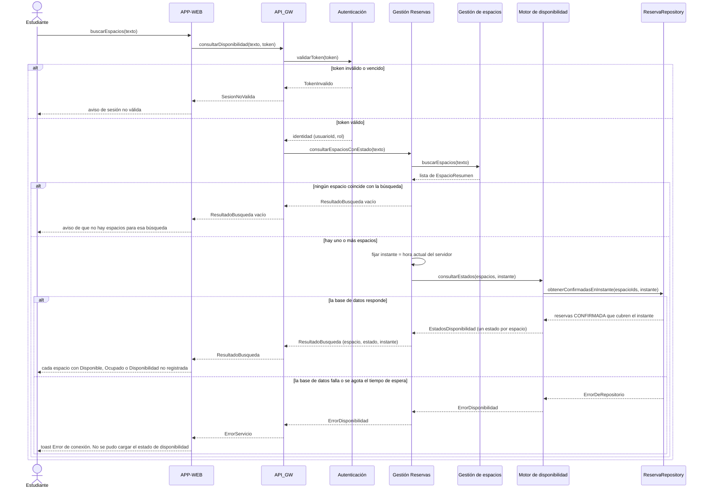
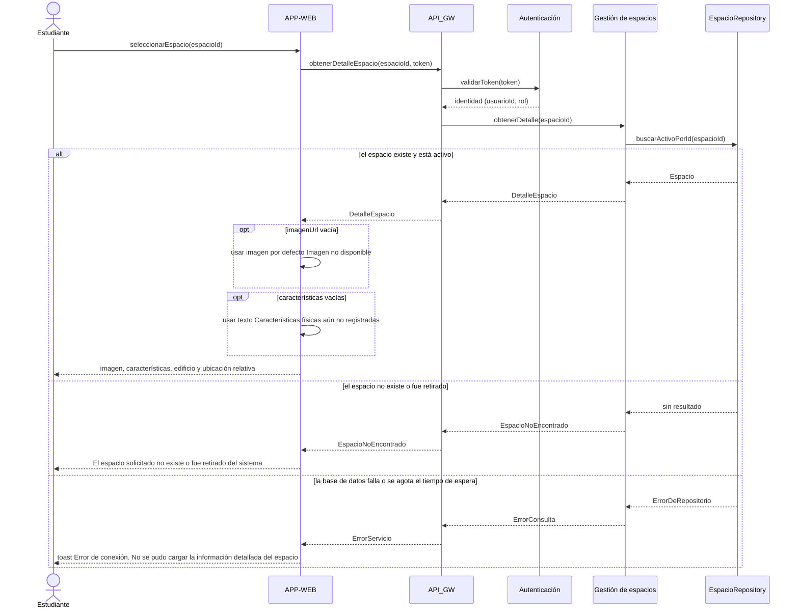
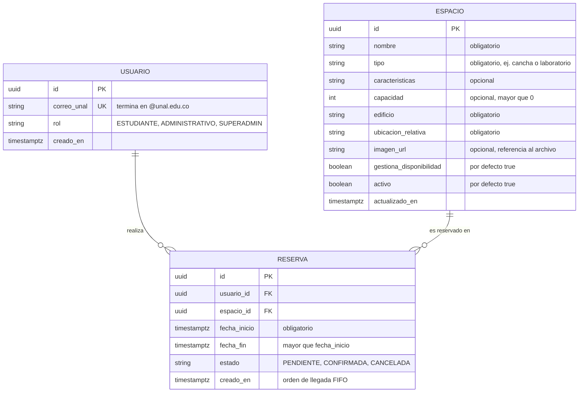

# UNAL-SPACE — Interaction & Data Design v1.0

| | |
|---|---|
| **Team** | UNAL-SPACE |
| **Members** | Oscar Andrés Andrade Medina, Oscar David Ariza Rojas, David Fernando Ordoñez Pérez, Juan Sebastián Rodríguez León |
| **Status** | Ready for review |
| **Date** | 2026-10-24 |
| **Inputs** | `docs/design/01_Architectural_and_Detailed_Design.md` (v1.1, actualizado por este entregable), Use Cases en `REQ-01.md` §4.3 y `REQ-02.md` §4.3, historias `docs/HU-001.md` y `HU-002.md`, `Workshop/Class15_AI_Decision_Log_oandradem.md`, borrador de base de datos `DB_000.sql` (rama `oariza`), Interaction & Contracts Design v0.1 (Clase 13) |

> **Nota sobre las fuentes.** Los casos de uso del equipo están escritos dentro de cada requerimiento (sección 4.3 de `REQ-01.md` y `REQ-02.md`) y no en una carpeta `docs/requirements/`. Cada diagrama de este documento traza a esos casos de uso. Nada de lo que aparece aquí agrega comportamiento de negocio: lo que los requerimientos no definen se marca como **Supuesto (S-x)** o como **Pregunta abierta (PA-x)** en la Sección 5.

---

## 1. Behavior — Selected Use Cases

Se seleccionan los dos casos de uso que el equipo ya especificó:

- **1.1 Consultar disponibilidad de espacios del campus** (REQ-02, requerimiento *capstone* del equipo). Es el caso que el Entregable 1 profundizó en su diseño detallado (DDR-01, Motor de disponibilidad, ADR de cálculo en tiempo real).
- **1.2 Consultar detalle de un espacio del campus** (REQ-01).

**Supuestos comunes a ambos diagramas**

- **S-1.** El estudiante ya inició sesión: el caso de uso pide como precondición que "se encuentra en la aplicación". Cada petición lleva un token JWT que el `API_GW` hace validar con `Autenticación` (DDR-04).
- **S-2.** El `API_GW` aplica un tiempo de espera de 10 segundos a cada petición, que es el límite de DDR-03 y HU-002. Si no hay respuesta en ese tiempo, devuelve un error de servicio y la `APP-WEB` muestra el *toast* de error de conexión del caso de uso.
- **S-3.** Los textos que ve el estudiante los decide la `APP-WEB`. Los componentes de la capa lógica devuelven datos o resultados tipados, no mensajes de interfaz.

### 1.1 Consultar disponibilidad de espacios del campus — from requirement REQ-02

| Use Case step or flow | Message(s) in the diagram | Information exchanged | Operation defined in (Deliverable 1) |
|---|---|---|---|
| Main flow, pasos 1–2: el estudiante entra a la sección de espacios y realiza la búsqueda | `buscarEspacios`, `consultarDisponibilidad`, `validarToken` | `texto` de búsqueda (puede ir vacío, S-4), token JWT, identidad | Acción del estudiante en `APP-WEB`. Enrutamiento de `API_GW`. `Autenticación.validarToken` (Tabla de Responsabilidades) |
| Main flow, paso 3: el sistema consulta el estado de los espacios encontrados | `consultarEspaciosConEstado`, `buscarEspacios`, `consultarEstados`, `obtenerConfirmadasEnInstante` | Lista de `EspacioResumen` (id, nombre, tipo, edificio, `gestionaDisponibilidad`). Un único `instante`. Reservas `CONFIRMADA` que cubren ese instante | `GestionReservas.consultarEspaciosConEstado`, `GestionEspacios.buscarEspacios`, `MotorDisponibilidad.consultarEstados`, `ReservaRepository.obtenerConfirmadasEnInstante` (Entregable 1 v1.1, §4) |
| Main flow, pasos 4–5: el sistema muestra el estado junto a cada espacio y el estudiante decide (Escenarios 1, 2 y 3) | Primera rama de "la base de datos responde" | `ResultadoBusqueda`: un par (espacio, estado) por espacio, todos evaluados en el mismo `instante` | Contrato de la Sección 3 |
| Alternative flow: espacio sin estado registrado (Escenario 4) | Misma rama. El estado `NO_REGISTRADO` viaja dentro de `EstadosDisponibilidad` y la `APP-WEB` lo muestra como "Disponibilidad no registrada" | `EstadoDisponibilidad.NO_REGISTRADO` para los espacios con `gestionaDisponibilidad = false` (S-5) | Enumeración `EstadoDisponibilidad` (Entregable 1) |
| Alternative flow: la búsqueda no devuelve espacios | Rama "ningún espacio coincide" | `ResultadoBusqueda` vacío. No se invoca al Motor | No está en el caso de uso actual de REQ-02. Ver PA-3 |
| Exception: fallo de conexión o timeout (Escenario 5) | Rama "la base de datos falla o se agota el tiempo de espera" | `ErrorDeRepositorio` → `ErrorDisponibilidad` → `ErrorServicio` | Manejo de fallos de `API_GW` (DDR-03). Ruta de excepción de `consultarEstados` (Sección 3) |
| Precondición: el estudiante está en la aplicación | Rama "token inválido o vencido" | `TokenInvalido` | `Autenticación` (DDR-04). Qué ve el estudiante en ese caso es PA-6 |

**Supuestos propios de este caso de uso**

- **S-4.** La "búsqueda" es un filtro por texto sobre el nombre del espacio, y un texto vacío devuelve todo el catálogo activo. Así lo sugiere la "Prueba de filtros" de HU-002 (nombre exacto o selección desde catálogo/lista). La forma definitiva del buscador sigue abierta en REQ-02 (Open Question #4).
- **S-5.** Un espacio tiene "disponibilidad no registrada" (Escenario 4) cuando no se gestiona mediante reservas en UNAL-SPACE. Esto se representa con el atributo `gestiona_disponibilidad = false` del espacio. Es la única lectura del Escenario 4 compatible con el cálculo dinámico que fijó el ADR de disponibilidad, porque con ese cálculo todo espacio que sí se reserva siempre tiene un estado calculable. Debe confirmarse con REQ-02 (Open Question #5) y está registrado como PA-2.
- **S-6.** "Al momento de realizar la búsqueda" significa el instante en que el servidor recibe la petición. Así lo decidió el ADR de cálculo de disponibilidad en tiempo real (Entregable 1, §7). `Gestión Reservas` fija ese instante una sola vez, y todos los espacios de un mismo resultado se evalúan con él.

*Revisión del diagrama.* Cada mensaje tiene un propósito y una operación que lo respalda. El orden respeta el caso de uso: primero se identifica al estudiante, luego se buscan los espacios y solo después se calculan sus estados. Cada rama termina con una respuesta visible para el estudiante. El Motor se invoca una sola vez por búsqueda, no una vez por espacio, de modo que el costo no crece con el número de resultados (DDR-03).

### 1.2 Consultar detalle de un espacio del campus — from requirement REQ-01

*La rama de token inválido es la misma del diagrama 1.1 y se omite aquí para no repetirla.*

| Use Case step or flow | Message(s) in the diagram | Information exchanged | Operation defined in (Deliverable 1) |
|---|---|---|---|
| Main flow, pasos 1–2: el estudiante navega y selecciona un espacio | `seleccionarEspacio`, `obtenerDetalleEspacio`, `validarToken` | `espacioId` (UUID), token | Acción del estudiante en `APP-WEB`. `API_GW`. `Autenticación` |
| Main flow, paso 3: el sistema busca la información del espacio | `obtenerDetalle`, `buscarActivoPorId` | `espacioId`. Fila de `ESPACIO` con `activo = true` | `GestionEspacios.obtenerDetalle`, `EspacioRepository.buscarActivoPorId` (Entregable 1 v1.1, §3 y §4) |
| Main flow, pasos 4–5: se muestran imagen, características, edificio y ubicación relativa (Escenarios 1 y 2) | Primera rama del `alt` | `DetalleEspacio`: nombre, tipo, `imagenUrl`, características, capacidad, edificio, ubicación relativa | `GestionEspacios.obtenerDetalle` |
| Alternative flow: el espacio no tiene imagen (Escenario 3) | `opt imagenUrl vacía` | `imagenUrl` nula. La `APP-WEB` aplica el *placeholder* | Presentación (`APP-WEB`). La ausencia de imagen es un dato y el *placeholder* es una decisión de interfaz |
| Alternative flow: faltan características físicas (Escenario 4) | `opt características vacías` | `caracteristicas` nula | Presentación (`APP-WEB`) |
| Exception: ID inválido, espacio borrado (Escenario 6) | Rama "el espacio no existe o fue retirado" | `EspacioNoEncontrado` | `GestionEspacios.obtenerDetalle` |
| Exception: fallo de conexión o timeout (Escenario 5) | Rama "la base de datos falla o se agota el tiempo de espera" | `ErrorDeRepositorio` → `ErrorConsulta` → `ErrorServicio` | Manejo de fallos de `API_GW` (DDR-03) |

*Revisión del diagrama.* El detalle del espacio lo entrega `Gestión de espacios`, que es el dueño de esa información (Sección 2.3), y no `Gestión Reservas` como trazaba la versión 1.0 del Entregable 1. Este cambio quedó registrado en la Sección 4. Un espacio "borrado" se trata como retirado (`activo = false`), porque las reservas históricas lo referencian y no se puede eliminar físicamente (Sección 2.4). Para el estudiante, "no existe" y "fue retirado" producen la misma respuesta, como pide el Escenario 6.

---

## 2. Data Design

### 2.1 Principal information the system needs

| Information | Needed by (use cases) | Persisted? | Why (or why not) |
|---|---|---|---|
| Espacios del campus: nombre, tipo, características físicas, capacidad, edificio, ubicación relativa, referencia a la imagen, si gestiona disponibilidad, si está activo | 1.1 y 1.2 | Sí | Es el catálogo que el estudiante consulta. Cambia poco y lo mantiene el administrador (REQ-01, Supuestos) |
| Reservas: espacio, usuario, franja de inicio y fin, estado | 1.1 (como insumo del cálculo) | Sí | Son la fuente de verdad de la disponibilidad (ADR de cálculo en tiempo real). Además, RF-03 exige comparar cada nueva solicitud con las reservas previas |
| Usuarios: correo institucional y rol | 1.1 y 1.2 (identidad del token). Toda reserva tiene un autor | Sí | Las reservas deben asociarse a una persona, y el rol (RF-04) define qué puede hacer cada usuario. El rol es un dato propio de UNAL-SPACE, no de la universidad |
| **Estado de disponibilidad** de un espacio | 1.1 | **No** | Se calcula en cada consulta a partir de las reservas confirmadas y del instante de la búsqueda (ADR de disponibilidad). Una copia guardada podría quedar desactualizada y sería una segunda fuente de verdad. Por la misma razón se rechazó usar caché (AI Log, decisión B3) |
| **Archivo** de la imagen representativa | 1.2 | **No en la base de datos** | En la base se guarda solo la referencia (`imagen_url`). Guardar el archivo en PostgreSQL haría más lentas las consultas del catálogo. Dónde se alojan los archivos sigue abierto (REQ-01, Open Question #2; aquí PA-4) |
| Resultado de una búsqueda (`ResultadoBusqueda`) | 1.1 | No | Es una respuesta transitoria: combina espacios con estados calculados en un instante, y vuelve a calcularse en la siguiente búsqueda |
| Token de sesión (JWT) | 1.1 y 1.2 | No | El token es autocontenido y se valida por firma y vencimiento. No hace falta una tabla de sesiones para los casos de uso de este documento |
| Notificaciones enviadas | Ninguno de estos dos casos de uso | No | Ningún requerimiento aprobado pide historial de notificaciones. El Servicio de Notificación solo envía mensajes (AI Log, decisión B2) |

### 2.2 Data model

**Justificación (relacional):**
> **Because** las reservas relacionan usuarios con espacios en franjas de tiempo, y la regla más importante del sistema es que dos reservas activas de un mismo espacio no se crucen (RF-03), incluso cuando llegan al tiempo (RNF-03); **we chose** el modelo relacional en PostgreSQL, que ya es el motor elegido en el ADR del stack y que permite imponer esa regla en los datos con una restricción de exclusión sobre rangos de tiempo; **accepting** un esquema más rígido que uno documental. Ese costo es bajo aquí, porque la estructura de espacios, usuarios y reservas es estable.

| Entity / document type | Meaning in the system | Identifier | Constraints (required, unique, allowed values) |
|---|---|---|---|
| `USUARIO` | Persona de la universidad que usa UNAL-SPACE | `id` (UUID) | `correo_unal` obligatorio, único y con dominio `@unal.edu.co` (DDR-04). `rol` obligatorio, con valores `ESTUDIANTE`, `ADMINISTRATIVO` o `SUPERADMIN` (RF-04) |
| `ESPACIO` | Lugar físico del campus que el estudiante puede consultar, como una cancha o un laboratorio (REQ-01) | `id` (UUID). REQ-01 supone un identificador único, porque existen enlaces directos y el caso "ID inválido" | `nombre`, `tipo`, `edificio` y `ubicacion_relativa` obligatorios, porque el Escenario 2 de REQ-01 siempre los muestra. `caracteristicas`, `capacidad` e `imagen_url` opcionales: su ausencia es un flujo alternativo de REQ-01 (Escenarios 3 y 4). Si `capacidad` existe, es mayor que 0. `gestiona_disponibilidad` y `activo` obligatorios |
| `RESERVA` | Uso de un espacio por un usuario durante una franja de tiempo | `id` (UUID) | `usuario_id` y `espacio_id` obligatorios, y no se pueden borrar los registros a los que apuntan (`ON DELETE RESTRICT`). `fecha_fin > fecha_inicio`. `estado` con valores `PENDIENTE`, `CONFIRMADA` o `CANCELADA`. Dos reservas `PENDIENTE` o `CONFIRMADA` del mismo espacio no pueden tener franjas que se crucen (RF-03). `creado_en` registra el orden de llegada para el criterio FIFO |

**Relación con el borrador `DB_000.sql` (rama `oariza`).** El modelo conserva tres ideas de ese borrador: los identificadores UUID, la validación del dominio `@unal.edu.co` y la restricción de exclusión con GiST sobre `(espacio_id, rango_horario)` para evitar cruces. **No** adopta sus reglas de negocio no aprobadas: solo días hábiles, horario de 06:00 a 21:00, duración entre 60 y 120 minutos, estados `FINALIZADA` y `NO_SHOW`, y restricción a espacios deportivos. Ningún requerimiento aprobado las contiene, así que quedan como pregunta abierta (PA-5) y no como restricciones del modelo.

### 2.3 Data Ownership

**Decisión de almacenamiento:**
> **Because** todos los componentes de la capa lógica se despliegan juntos en el backend de Node.js y comparten el mismo motor (ADR del stack); **we chose** una sola base de datos PostgreSQL en la que cada tabla tiene un único componente dueño, y ningún componente accede con SQL a las tablas de otro, sino a través del repositorio o la operación del dueño; **accepting** que esa separación depende de la disciplina del código y no de bases de datos físicamente separadas. Separarlas no tendría ningún beneficio en un MVP de este tamaño.

| Information | Authoritative owner (component responsible for maintaining it) | Consumed by (uses it without owning it) | Access through |
|---|---|---|---|
| Espacios (`ESPACIO`) | **Gestión de espacios y elementos**. Los crea, actualiza y retira el administrador | Gestión Reservas (compone los resultados de la búsqueda). Motor de disponibilidad (solo `id` y `gestionaDisponibilidad`, que le pasa Gestión Reservas). APP-WEB (muestra el detalle) | `GestionEspacios.buscarEspacios`, `GestionEspacios.obtenerDetalle`. `EspacioRepository` es interno de Gestión de espacios |
| Reservas (`RESERVA`) | **Gestión Reservas**. Es el único componente que crea reservas o cambia su estado (`crearReserva`, `Reserva.confirmar`) | Motor de disponibilidad, solo lectura | `ReservaRepository.obtenerConfirmadasEnInstante` (consulta de solo lectura que expone el dueño) |
| Usuarios (`USUARIO`) | **Autenticación** | API_GW (identidad y rol del token). Gestión Reservas (`usuarioId` del token, nunca enviado por el cliente) | `Autenticación.validarToken` |
| Estado de disponibilidad (calculado, no guardado) | **Motor de disponibilidad**, que lo calcula | Gestión Reservas → API_GW → APP-WEB | `MotorDisponibilidad.consultarEstados` (Sección 3) |
| Archivo de imagen | Almacenamiento de archivos aún no definido (PA-4). Gestión de espacios es dueño de la **referencia** `imagen_url` | APP-WEB (descarga la imagen con la URL) | `DetalleEspacio.imagenUrl` |

### 2.4 Business rules and invariants enforced in data

| Business rule or invariant | Where it is enforced (component logic / data constraint / both) | How |
|---|---|---|
| RF-03: se rechaza toda solicitud cuya franja se cruce con una reserva previa del mismo espacio | Ambos | Lógica: `MotorDisponibilidad.validarFranja` antes de crear la reserva. Datos: `EXCLUDE USING gist (espacio_id WITH =, tstzrange(fecha_inicio, fecha_fin, '[)') WITH &&) WHERE estado IN ('PENDIENTE','CONFIRMADA')`. La restricción en datos garantiza la integridad aunque dos solicitudes simultáneas pasen la validación lógica al mismo tiempo (RNF-03) |
| Una reserva termina después de empezar | Datos | `CHECK (fecha_fin > fecha_inicio)` |
| Solo una reserva `CONFIRMADA` vuelve "Ocupado" a un espacio, y la franja es cerrada al inicio y abierta al final (`[inicio, fin)`) | Lógica | `ReservaRepository.obtenerConfirmadasEnInstante` filtra `estado = 'CONFIRMADA' AND fecha_inicio <= instante AND instante < fecha_fin`. Gracias a la restricción de exclusión hay como máximo una reserva así por espacio, de modo que el estado nunca es ambiguo |
| Consultas de disponibilidad rápidas bajo carga (DDR-03), sin caché (decisión B3) | Datos | Índice compuesto `(espacio_id, estado, fecha_inicio, fecha_fin)` sobre `RESERVA` |
| Un estudiante solo ve espacios activos. Un espacio retirado se comporta como inexistente (REQ-01, Escenario 6) | Ambos | Datos: `activo BOOLEAN NOT NULL DEFAULT true`, y `ON DELETE RESTRICT` desde `RESERVA` impide borrar espacios con historial. Lógica: `buscarEspacios` y `buscarActivoPorId` filtran `activo = true` |
| Solo usuarios de la universidad (DDR-04) | Ambos | Lógica: `Autenticación` rechaza correos de otro dominio. Datos: `CHECK (correo_unal ~* '@unal\.edu\.co$')` y `UNIQUE (correo_unal)` |
| Rol con valores cerrados (RF-04) | Datos | `CHECK (rol IN ('ESTUDIANTE','ADMINISTRATIVO','SUPERADMIN'))` |
| Estado de reserva con valores cerrados, que solo se cambia desde Gestión Reservas | Ambos | Datos: `CHECK (estado IN ('PENDIENTE','CONFIRMADA','CANCELADA'))`. Lógica: el estado solo cambia con métodos de `Reserva` como `confirmar()` (ocultamiento de información, Entregable 1 §6) |
| Atributos obligatorios del espacio que muestra el detalle (REQ-01, Escenario 2) | Datos | `NOT NULL` en `nombre`, `tipo`, `edificio` y `ubicacion_relativa`. `CHECK (capacidad IS NULL OR capacidad > 0)` |

---

## 3. Interface Contract

**Interaction chosen** (diagrama 1.1, mensaje `consultarEstados` de `Gestión Reservas` a `Motor de disponibilidad`):
> Es el punto donde se decide lo que promete el requerimiento capstone, es decir, qué estado ve el estudiante. También es donde la decisión del ADR (calcular en vez de guardar) se vuelve una operación verificable.

| Element | Specification |
|---|---|
| **Operation and purpose** | `consultarEstados(espacios, instante)`: calcula, para cada espacio recibido, su estado de disponibilidad en un mismo instante, a partir de las reservas confirmadas |
| **Input** (parameters and types) | `espacios`: lista no vacía de `EspacioRef { id: UUID, gestionaDisponibilidad: boolean }`, sin ids repetidos, tal como la entrega `GestionEspacios.buscarEspacios`. `instante`: `DateTime` con zona horaria, fijado por el llamador |
| **Output** (successful result and data structure) | `EstadosDisponibilidad { instante: DateTime, estados: Map<UUID, EstadoDisponibilidad> }`, con exactamente una entrada por cada `id` de la entrada. `EstadoDisponibilidad` ∈ {`DISPONIBLE`, `OCUPADO`, `NO_REGISTRADO`} |
| **Preconditions** (what the caller must satisfy before invoking) | El llamador (`Gestión Reservas`) obtuvo los espacios de `Gestión de espacios`, así que existen y están activos. La lista no está vacía y no tiene ids repetidos. `instante` no es nulo |
| **Postconditions** (what is guaranteed on successful completion) | Para cada espacio: `NO_REGISTRADO` si `gestionaDisponibilidad = false`. Si no, `OCUPADO` si y solo si existe una `RESERVA` con `estado = CONFIRMADA` y `fecha_inicio <= instante < fecha_fin`. En los demás casos, `DISPONIBLE`. Todos los estados corresponden al mismo `instante`, que se devuelve en la salida |
| **Failure outcomes** (each failure, and what state is left after it) | `EntradaInvalida`: lista vacía, ids repetidos o `instante` nulo. No se consulta el repositorio. `ErrorDisponibilidad`: el repositorio falla o se agota el tiempo de espera. No se devuelven resultados parciales, de modo que el estudiante nunca ve una mezcla de estados calculados y faltantes. Se registra el fallo en el log. En todos los casos ninguna reserva ni ningún espacio cambia |
| **Invariants and side effects** (what must stay true, what may change) | Operación de solo lectura: no crea, modifica ni guarda reservas, espacios ni estados, y no usa caché (ADR de disponibilidad, decisión B3). Es idempotente: con el mismo `instante` y las mismas reservas devuelve el mismo resultado. Hace como máximo una consulta al repositorio por invocación, cualquiera que sea el número de espacios (ninguna si todos tienen `gestionaDisponibilidad = false`). Único efecto lateral: una entrada de log cuando ocurre `ErrorDisponibilidad` |

**Testable examples**

Datos de partida para todos los casos: el espacio `E1` (cancha, `gestionaDisponibilidad = true`) tiene una reserva `R1` `CONFIRMADA` de 10:00 a 12:00 del 2026-10-27 (hora de Bogotá). El espacio `E2` (laboratorio, `gestionaDisponibilidad = true`) tiene una reserva `R2` `CANCELADA` de 10:00 a 12:00 del mismo día. El espacio `E3` tiene `gestionaDisponibilidad = false`.

| Case | Before | Request | Expected |
|---|---|---|---|
| Dentro de una reserva confirmada | Datos de partida | `consultarEstados([E1], 2026-10-27 11:00)` | `E1 → OCUPADO` |
| Justo al inicio de la franja | Datos de partida | `consultarEstados([E1], 2026-10-27 10:00)` | `E1 → OCUPADO` (el inicio está incluido) |
| Justo al final de la franja | Datos de partida | `consultarEstados([E1], 2026-10-27 12:00)` | `E1 → DISPONIBLE` (el fin está excluido) |
| Reserva cancelada | Datos de partida | `consultarEstados([E2], 2026-10-27 11:00)` | `E2 → DISPONIBLE` |
| Varios espacios en una búsqueda (Escenario 3) | Datos de partida | `consultarEstados([E1, E2, E3], 2026-10-27 11:00)` | `E1 → OCUPADO`, `E2 → DISPONIBLE`, `E3 → NO_REGISTRADO`, todos con `instante = 11:00` |
| Lista vacía | Datos de partida | `consultarEstados([], 2026-10-27 11:00)` | `EntradaInvalida`. No se consulta el repositorio |
| Base de datos caída | El repositorio no responde | `consultarEstados([E1, E2], 2026-10-27 11:00)` | `ErrorDisponibilidad`, sin estados parciales. `R1` y `R2` sin cambios |

---

## 4. Cross-Consistency & Changes to Deliverable 1

| Check | Result |
|---|---|
| Every participant in a sequence diagram is an actor, a component, a class or an external system from Deliverable 1 | Sí. Estudiante es el actor USER del diagrama de componentes. `APP-WEB`, `API_GW`, `Autenticación`, `Gestión Reservas`, `Gestión de espacios y elementos` y `Motor de disponibilidad y horarios` son componentes del diagrama arquitectónico. `ReservaRepository` y `EspacioRepository` son clases que se agregaron al diseño detallado (cambios C1 y C5) |
| Every message corresponds to a capability, operation or contract | Sí. `buscarEspacios`, `seleccionarEspacio`, `consultarDisponibilidad` y `obtenerDetalleEspacio` son acciones del estudiante o entradas que el `API_GW` enruta. `validarToken` pertenece a `Autenticación`. `consultarEspaciosConEstado`, `buscarEspacios`, `obtenerDetalle`, `consultarEstados`, `obtenerConfirmadasEnInstante` y `buscarActivoPorId` están en el diagrama de clases v1.1 |
| Every entity or document type is reflected in the class diagrams, or the reason it is not is stated | Sí. `USUARIO`, `ESPACIO` y `RESERVA` corresponden a las clases `Usuario`, `Espacio` y `Reserva`. `Espacio` se amplió con los atributos que REQ-01 necesita (cambio C6). El estado de disponibilidad no es una entidad, porque se calcula (enumeración `EstadoDisponibilidad`) |
| Every persisted information element has exactly one authoritative owner | Sí (Tabla 2.3). Cada tabla tiene un solo dueño, y el Motor solo lee reservas mediante la consulta que expone Gestión Reservas |
| The contract agrees with the sequence diagram and with the data model (same behavior in all three views) | Sí. La salida de `consultarEstados` produce las dos ramas del `alt` interno de 1.1: el éxito con los tres estados y el fallo con `ErrorDisponibilidad`. La lista vacía nunca llega al Motor, porque 1.1 la resuelve antes, lo que coincide con la precondición. La regla `OCUPADO` usa los mismos campos (`estado`, `fecha_inicio`, `fecha_fin`) y la misma franja `[inicio, fin)` que el modelo y la restricción de exclusión de 2.4. Que la operación sea de solo lectura coincide con 2.1: el estado no se guarda |

**Changes made to Deliverable 1 because of this deliverable**

> El documento `01_Architectural_and_Detailed_Design.md` se actualizó a **v1.1** en el mismo commit. Los cambios son:
>
> - **C1. El Motor ya no accede a SQL directamente** (decisión B1 del AI Decision Log, que estaba registrada pero no aplicada). `MotorDisponibilidad` usa `ReservaRepository`, y su consulta pasó a recibir un lote: `obtenerConfirmadasEnInstante(espacioIds, instante)`.
> - **C2. La consulta de disponibilidad acepta varios espacios.** `GestionReservas.consultarEspacioConEstado(espacioId)` pasó a ser `consultarEspaciosConEstado(texto)` y devuelve una lista. El caso de uso de REQ-02 parte de una búsqueda que devuelve varios espacios (Escenario 3), algo que la versión con un solo espacio no podía representar.
> - **C3. El Motor calcula todos los espacios en una sola llamada.** `consultarEstadoActual(espacioId)` pasó a ser `consultarEstados(espacios, instante)`. Así se evita una consulta por espacio, que con N resultados ponía en riesgo DDR-03. Además, recibir `instante` como parámetro garantiza que todos los espacios de una búsqueda se evalúan en el mismo momento y vuelve la operación verificable (Sección 3).
> - **C4. Se corrigió el significado de `NO_REGISTRADO`.** En v1.0 el pseudocódigo lo devolvía cuando el espacio no existía. Al concretar los datos se vio que "no existe" es otro caso (REQ-01, Escenario 6, ahora `EspacioNoEncontrado`), y que con el cálculo dinámico todo espacio que se reserva siempre tiene estado. `NO_REGISTRADO` pasa a significar "espacio sin gestión de disponibilidad" (`gestionaDisponibilidad = false`, S-5 y PA-2).
> - **C5. REQ-01 ahora traza a `Gestión de espacios y elementos`.** En v1.0 la matriz trazaba REQ-01 a `Gestión Reservas`. Al definir el ownership se vio que la información del espacio pertenece a `Gestión de espacios y elementos`, que ya estaba en el diagrama arquitectónico. Se agregó su fila a la tabla de responsabilidades y la clase `GestionEspacios` con `buscarEspacios`, `obtenerDetalle` y `EspacioRepository`.
> - **C6. `Espacio` tiene los atributos que REQ-01 necesita.** Se agregaron `tipo`, `caracteristicas`, `capacidad`, `edificio`, `ubicacionRelativa`, `imagenUrl`, `gestionaDisponibilidad` y `activo`. En v1.0 la clase solo tenía `id`, `nombre` y `ubicacion`, y no podía cumplir REQ-01.
> - **C7. La relación entre `GestionReservas` y `Reserva` es una asociación.** En v1.0 se dibujaba como composición (rombo lleno). Las reservas son entidades persistidas a las que se accede por `ReservaRepository`, y su ciclo de vida no depende de una instancia del servicio.
> - **C8. Se aplicaron las decisiones B2, B3 y B4 del AI Log.** Se agregó la fila del Servicio de Notificación como dependencia no bloqueante, el índice compuesto de reservas y las preguntas abiertas sobre JWT y políticas en la Sección 8.
> - **C9. Los diagramas de clases se mantienen al día en Mermaid.** El diagrama de clases v1.1 se incluye en Mermaid dentro del Entregable 1, y la imagen `02_class_diagram.jpg` se regeneró a partir de él. El diagrama de componentes no cambia.

---

## 5. Open Questions

> - **PA-1. ¿Cuál es el requerimiento capstone?** Este documento asume que es REQ-02, porque es el que el Entregable 1 desarrolló en su diseño detallado. Si el equipo eligió REQ-01, ambos casos de uso ya están cubiertos y solo cambia la etiqueta de la Sección 1.
> - **PA-2. ¿Qué significa "disponibilidad no registrada"?** (REQ-02, Open Questions #2 y #5). Este diseño lo interpreta como "espacio que no se gestiona mediante reservas" (S-5). Hay que confirmar con los stakeholders si existen espacios así, o si el estado "En mantenimiento" que aparecía en el borrador `REQ-001.2` es un estado adicional. Si lo es, habría que agregar un valor al enum y un origen de datos para él.
> - **PA-3. ¿Qué ve el estudiante cuando la búsqueda no devuelve espacios?** El caso de uso actual de REQ-02 no define ese flujo. El borrador anterior `REQ-001.2` tenía el mensaje "No se encontró el espacio especificado…". Mientras no se decida, el diagrama 1.1 devuelve un resultado vacío y no se fija ningún texto.
> - **PA-4. ¿Dónde se alojan las imágenes y cuánto pueden pesar?** (REQ-01, Open Question #2). El modelo guarda solo `imagen_url`. Tampoco está definido qué ocurre si la URL existe pero el archivo no se puede descargar. Por ahora se supone que la `APP-WEB` aplica el mismo *placeholder* del Escenario 3.
> - **PA-5. ¿Las reglas del borrador `DB_000.sql` son reglas de negocio aprobadas?** Ese borrador limita las reservas a días hábiles, de 06:00 a 21:00, con duración de 60 a 120 minutos, y agrega los estados `FINALIZADA` y `NO_SHOW`. No se incluyeron en el modelo porque ningún requerimiento las respalda.
> - **PA-6. ¿Qué pasa cuando el token es inválido o venció?** Hay que definir qué ve el estudiante (por ejemplo, redirección al inicio de sesión) y cuál es el tiempo de inactividad que exige RNF-04. También falta definir si la identidad institucional la provee un sistema externo de la universidad (SSO) o UNAL-SPACE mismo. Si fuera externo, `Autenticación` solo guardaría el correo y el rol.
> - **PA-7. Fallo parcial en la búsqueda.** Si los espacios se obtienen pero el cálculo de disponibilidad falla, el caso de uso detiene todo y muestra el *toast* (Excepción de REQ-02). ¿Sería preferible mostrar la lista sin estados? Este diseño sigue el caso de uso tal como está escrito.
> - **PA-8. ¿El detalle de un espacio también debe mostrar su estado?** La "Prueba de filtros" de HU-002 menciona la selección desde el catálogo, y REQ-01 tiene la Open Question #3. El diagrama 1.2 no incluye el estado. Si se agrega, `obtenerDetalleEspacio` tendría que pasar por `Gestión Reservas` igual que en 1.1.

## 6. Consistency Checklist

- [x] Two use cases from the project, each traceable to a Use Case written in the requirements. *(1.1 → REQ-02 §4.3. 1.2 → REQ-01 §4.3.)*
- [x] Each sequence diagram shows the main flow and at least one alternative or exception flow.
- [x] No business behavior is invented: anything unspecified is marked as an assumption or Open Question. *(S-1 a S-6, PA-1 a PA-8.)*
- [x] Section 2.1 explains what is NOT persisted as well as what is.
- [x] The data model has identifiers, relationships and constraints, not only boxes.
- [x] Every piece of principal information has one authoritative owner, and consumers are listed (Section 2.3).
- [x] The contract defines input, output, preconditions, postconditions and failure outcomes.
- [x] Sequence, data model and contract describe the same behavior.
- [x] Diagrams render correctly on GitHub (or the exported images are embedded).
