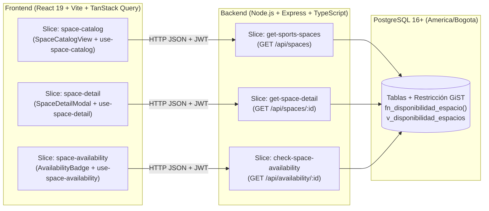

# RFC-001: Primer Incremento (MVP) de UNALSpace — Consulta de Disponibilidad, Detalle y Ubicación de Espacios Deportivos

Autores:
 - Oscar David Ariza Rojas (@OarizaR)
 - Oscar Andrés Andrade Medina (@oscarmedina0116)
 - David Fernando Ordoñez Pérez (@dordonezpe)
 - Juan Sebastián Rodríguez León (@jrodriguezleo)

## 1. Resumen Ejecutivo

Este documento define el diseño técnico y funcional del **Primer Incremento (Sprint 1 / MVP)** de **UNALSpace** para la Universidad Nacional de Colombia (Sede Bogotá), enfocado exclusivamente en los **12 Espacios Deportivos** del campus e implementando los casos de uso **[REQ-01] Consultar Detalle y Ubicación de Espacios** y **[REQ-02] Consultar Disponibilidad de Espacios** bajo **Vertical Slice Architecture (VSA)** y **PostgreSQL 16+**.

## 2. Motivación

Los estudiantes de la Sede Bogotá no cuentan con un canal unificado para verificar en tiempo real si una cancha o escenario deportivo está libre u ocupado antes de desplazarse hasta la zona deportiva del campus. Este primer incremento entrega valor inmediato al estudiante permitiéndole:
- Consultar el estado en tiempo real (**`"Disponible"`**, **`"Ocupado"`** o **`"Disponibilidad no registrada"`**) por fecha y franja horaria.
- Inspeccionar la ficha técnica completa de cada escenario (ilustración arquitectónica de alta resolución, capacidad, condición de techo, tipo de superficie, deportes permitidos y ubicación de referencia en el campus).
- Autenticar su sesión local mediante su correo institucional `@unal.edu.co`.

## 3. Propuesta de Implementación

### 3.1 Flujo de Arquitectura Vertical Slice (VSA)

### 3.2 Convenciones de Nombramiento y Documentación

| Elemento | Convención | Ejemplo |
| :--- | :--- | :--- |
| **Clases** | `PascalCase`, sustantivos | `SpaceDetailService`, `CheckAvailabilityController` |
| **Métodos** | `camelCase`, empiezan con verbo | `getSpaceDetailById()`, `checkSpaceAvailability()` |
| **Variables** | `camelCase`, descriptivas | `searchParameters`, `queryString`, `apiResponse` |
| **Constants** | `UPPER_SNAKE_CASE` | `SPACE_DETAIL_QUERY_KEY`, `API_BASE_URL` |
| **Archivos** | `kebab-case` o igual que la clase | `use-space-detail.ts`, `SpaceCatalogView.tsx` |
| **Carpetas** | `kebab-case` o minúsculas | `space-detail/`, `check-space-availability/` |

Todos los métodos incluyen documentación **JSDoc/TSDoc** indicando qué hace el método, qué parámetros recibe (`@param`) y qué retorna (`@returns`).

## 4. Métricas y Requisitos No Funcionales

- **Tiempo de respuesta (`DDR-03`):** Límite máximo de **10 segundos** (`API_TIMEOUT_MS = 10000`) tanto en el cliente HTTP como en el gateway del backend; bajo carga normal en PostgreSQL 16+, las consultas responden en `< 50 ms`.
- **Sincronización reactiva:** Al registrar o liberar una reserva en PostgreSQL, TanStack Query invalida las claves `sports-spaces-catalog`, `space-detail` y `space-daily-availability`, actualizando la interfaz de forma inmediata.
